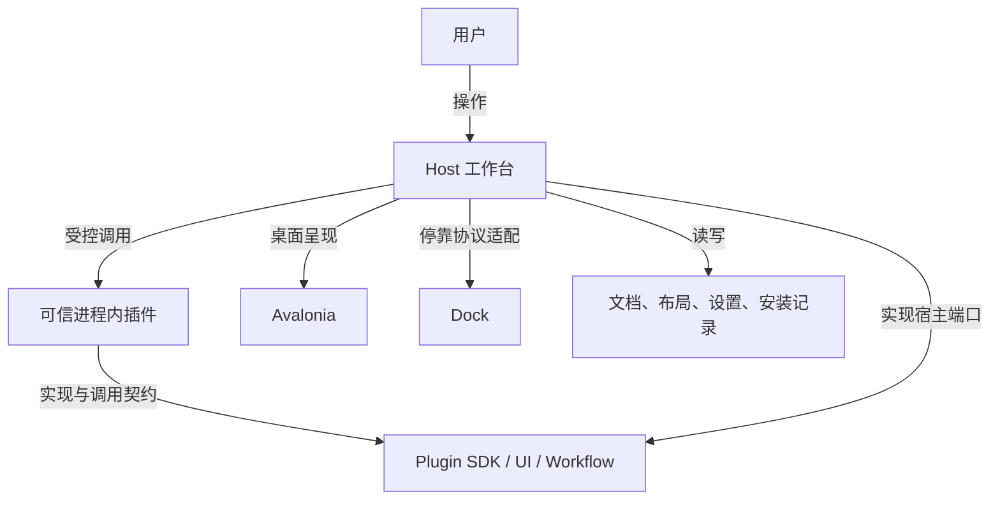

# 系统边界：Host、插件、SDK 与框架

> 层级：Host 全景。核对日期：2026-09-28。依据：当前工作树源码、现行契约及文中测试；不代表发布或实机验收结论。

[返回文档总览](../README.md)

## 先看 Host 解决的问题

Host 是一个可扩展桌面工作台。用户同时处理多个工作页面，使用辅助工具，保存文件，并希望窗口布局、插件状态和关闭行为一致。Host 提供这些共同机制；业务插件决定页面内容、领域规则和后台服务。一个插件可以贡献多个页面类型、工具和操作。

这里的“领域模块”指本文采用的职责分区，不表示九个独立进程、九套容器或九个严格的 DDD 限界上下文。生产应用主要处于同一进程，同一 Runtime 组合出协作对象。

图中连线表示使用关系，不表示项目引用方向。Host 与插件都引用 SDK；插件通过 SDK 端口获得能力，无需引用 Host 程序集。

## 四条边界

| 边界 | Host 一侧 | 插件一侧 |
| --- | --- | --- |
| 业务 | 创建、显示、保存、关闭的编排 | 内容含义、业务验证、领域服务 |
| 容器 | Host Provider、每插件 Provider 的组织与释放 | 在自己的服务集合内注册依赖 |
| UI | 主窗、Dock、全局主题、窗口交互端口 | 普通页面模型、精确注册的 View、局部样式 |
| 持久化 | 文件信封、身份、原子提交、恢复保护 | 内容版本、JSON 内容、内容修订状态 |

Host 只向插件提供明确端口，不把整个 Host 服务容器开放出去。共享 UI 类型必须遵守程序集共享策略；插件私有依赖由插件加载上下文解析。容器隔离和程序集隔离解决的问题不同，见[插件发现](../02-plugins/01-discovery-and-loading.md)。

## SDK 三个面

基础 SDK 声明页面、工具、身份、持久化和调用契约；UI SDK 提供 Avalonia 相关注册与窗口能力；Workflow SDK 承载 Workflow Schema、引用及目录修订辅助规则。它们的精确 public surface 以各包源码和现有 API 基线为准。

Host 承担桌面后端、字体和全局主题组合。SDK 的存在不意味着每个 Host internal 类都是插件扩展点。修改内部协调器时，应首先检查它是否改变了 SDK 可观察行为。

## 支持与交付边界

当前支持同团队可信 Managed Plugin，运行中不热卸载插件。安装或替换插件通过后续启动应用；本地 ZIP 安装与在线插件源属于不同能力，后者仍是暂停方案。本文解释当前源码，不把部署、人工验收或公开发布状态从“代码存在”推导出来。

版本与平台的权威信息见[平台基线](../../reference/platform-baseline.md)，本地安装见[安装契约](../../reference/plugin-installation.md)。业务插件仓库仅作为外部消费者，本组文档不展开它们的业务实现。

## 阅读到代码

先读 [Program](../../../Host/MyAvaloniaManagement/Program.cs) 确认进程入口，再读 [Host 工程引用](../../../Host/MyAvaloniaManagement/MyAvaloniaManagement.csproj) 与 [Runtime](../../../Host/MyAvaloniaManagement/Business/Composition/HostRuntime.cs)。边界保护见 [HostApiBoundaryTests](../../../Host/MyAvaloniaManagement.Tests/HostApiBoundaryTests.cs) 和 [PluginSdkDependencyBoundaryTests](../../../Host/MyAvaloniaManagement.PluginTests/PluginSdkDependencyBoundaryTests.cs)。

下一篇：[核心概念](02-core-concepts.md)。
