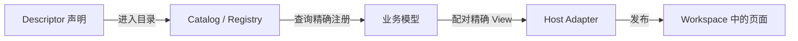

# 核心概念：先分清声明、实例、呈现和所有权

> 层级：Host 全景。核对日期：2026-09-28。依据：当前工作树源码、现行契约及文中测试；不代表发布或实机验收结论。

[返回文档总览](../README.md)

## 一条从声明到页面的链

“插件声明了一个 Document 类型”只意味着系统知道它可以创建什么；尚未创建页面、View 或文档 Scope。用户发起新建后，Host 才按注册所有者构造模型和 View。发布成功才成为可操作页面。

## 核心名词

| 概念 | 回答的问题 | 容易混淆的地方 |
| --- | --- | --- |
| PluginId | 哪个插件拥有贡献 | 不从文件夹名或窗口标题猜测 |
| DocumentTypeId | 这是什么页面类型 | 同类型可以同时打开多个实例 |
| CreationIntentId | 以哪种创建意图进入类型 | 不是实例 ID，也不是文件路径 |
| WorkspacePageId | 本次运行中的哪一个页面 | 不作为跨启动文档恢复键 |
| Descriptor / Registration | 声明了什么，以及如何精确构造 | 不等于运行中的模型 |
| Registry | 已提交的真实插件贡献事实 | 不保存活跃窗口或 Provider |
| Catalog | 面向用途组织的只读目录 | Workspace Catalog 和 Command Catalog 内容不同 |
| Provider | 一个 DI 服务容器 | Host 与各插件分别拥有自己的容器 |
| Scope | 一组有共同寿命的实例 | Document Scope 与 Workflow 调用 Scope 相互独立 |
| Lease | 限定责任或有效期的凭据 | 各种 Lease 含义不同，不能统一当锁理解 |

## Document 与 Tool

Document 是独立工作实例。通常每次创建获得独立 Scope；它可以持久化，也可以只是临时页面。是否可保存由模型能力和规范注册共同决定。

Tool 是辅助面板，模型由所属 Provider 作为单例持有。关闭 Tool 通常表示隐藏，重新显示复用原实例。Tool 面板隐藏不等于插件后台业务服务停止。Document 真正关闭则会走 View、关闭令牌和 Scope 的释放链。

| 对象 | 可多实例 | 关闭含义 | 生命周期主要边界 |
| --- | --- | --- | --- |
| Document 页面 | 是 | 完成关闭后释放 | 单个 Document Scope |
| Tool 面板 | 同一注册项复用 | 隐藏或重新停靠 | Session 的 Adapter/View 与 Provider 的模型 |
| 插件服务 | 按插件注册 | 与面板是否可见无直接等价关系 | Provider、Scope 或插件自己的业务协议 |

## Workspace、Dock、Layout

Workspace 回答“当前有哪些工作实例、谁是活动文档、哪些工具存在”；Dock 回答“如何停靠和接收框架操作”；Layout 回答“如何把空间结构变为快照并恢复”。窗口移动不会创建新的业务文档 Scope。保存布局也不等于保存文档内容。

## Command 与 Workflow Action

Workbench Command 表达用户在工作台中的操作，如保存当前文档。执行依赖当前上下文，并必须再次检查目标。

Workflow Action 表达插件对其他插件公开的 JSON 能力调用。它有调用者身份、输入输出约束和独立执行 Scope，不依赖当前活动页面。二者分别有执行器与退出等待机制。

## “成功”也有层次

插件文件已安装、声明已注册、生命周期可用、页面初始化成功、页面已发布，是不同事实。页面保存主文件成功和保存后确认成功也不同。阅读后面的状态图时，应一直问：这里的状态属于谁，哪个步骤才提交它？

概念的完整查找入口见[术语表](../11-reference/01-glossary.md)，所有权见[所有权矩阵](../11-reference/02-ownership-and-threading.md)。
