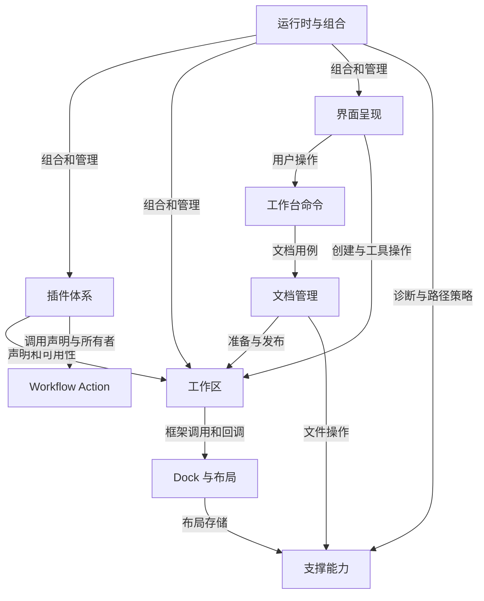

# Host 模块地图：职责与交互

> 层级：Host 全景。核对日期：2026-09-28。依据：当前工作树源码、现行契约及文中测试；不代表发布或实机验收结论。

[返回文档总览](../README.md)

## 第一张模块图

这是主要协作关系的概念图，省略了通知和局部反向回调。它不是完整源码依赖图。界面上的功能中心等入口会经过文档用例，图中的“创建与工具操作”是整体工作区意图。

## 每个框如何继续放大

| 模块 | 核心问题 | 对外协作 | 下钻 |
| --- | --- | --- | --- |
| 运行时与组合 | 对象如何建立、退出和回滚 | 消费各模块关闭结论 | [运行时](../01-runtime/README.md) |
| 插件体系 | 哪些贡献合法、归谁所有、是否可用 | 发布声明与运行可用性 | [插件](../02-plugins/README.md) |
| 工作区 | 哪些实例存在、如何发布和激活 | 消费目录、协调 Dock 与页面生命周期 | [工作区](../03-workspace/README.md) |
| 文档管理 | 如何创建、读写、恢复、确认关闭 | 使用 Workspace 和 Storage | [文档](../04-documents/README.md) |
| Dock 与布局 | 空间结构如何变化和保存 | 适配框架，复用已有业务实例 | [Dock 与布局](../05-docking-layout/README.md) |
| 工作台命令 | 当前用户操作是否可执行、目标是谁 | 捕获 Workspace 上下文并调用用例 | [命令](../06-commands/README.md) |
| Workflow Action | 如何治理跨插件能力调用 | 从所属插件 Scope 解析 Handler | [Workflow](../07-workflow-actions/README.md) |
| 界面呈现 | 如何把事实与操作呈现给用户 | 查询快照、调用窄端口 | [呈现](../08-presentation/README.md) |
| 支撑能力 | 如何提供文件、诊断和证据 | 服务多个上层模块 | [基础能力](../09-infrastructure/README.md) |

## 三种关键交互方式

**直接用例调用**：用户新建页面，调用文档协调器，再调用 Session。调用者可以等待成功或失败，不能仅凭“已发事件”当作完成。

**只读投影**：工具中心读取当前工具状态；命令面板合并创建入口、已有页面、工具和命令。快照便于展示，但执行时仍重查真实状态。

**定向状态通知**：Session 发布活动文档变化，消费者更新当前目标。通知表达特定事实，不是任意消息广播。订阅者负责解除订阅。

## 横跨模块的两条线

第一条是所有权：创建模型时要知道对应 Provider 和 Scope，关闭时要证明相关调用已结束。第二条是提交点：目录提交、页面发布、主文件写入、安装确认分别有自己的成功条件，不能互相代替。

因此，一个类位于某个目录，并不意味着它可以独占整条流程。例如文档关闭同时涉及文档确认、命令等待、Dock 回调、控件缓存和 Scope。细节见[关闭机制](../04-documents/06-close-and-release.md)。

下一篇：[从启动到退出](04-runtime-story.md)。
