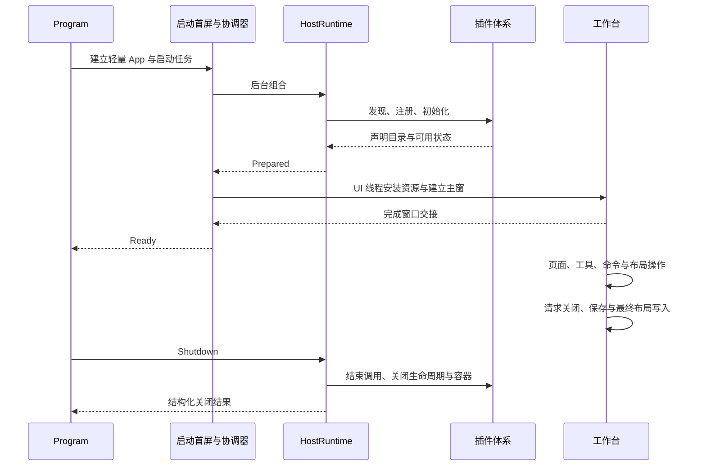

# 从启动到退出：一次 Host 运行的故事

> 层级：Host 全景。核对日期：2026-09-28。依据：当前工作树源码、现行契约及文中测试；不代表发布或实机验收结论。

[返回文档总览](../README.md)

## 按时间认识系统

该图省略安装与重启分支。Windows 正常启动在插件发现前还会准备安装会话，处理待应用安装或恢复。重启助手参数则在最早入口被分流，不进入普通插件启动链。

## 第一段：先让启动可观察

首屏只使用轻量依赖，不提前解析完整 Workspace。StartupCoordinator 拥有启动任务与状态，StartupDesktopShell 负责把进度呈现给用户。后台组合结束是 Prepared；真正主窗口完成展示后才进入 Ready。

这个区分让“插件已初始化但主窗创建失败”仍可作为启动失败处理。取消请求也不能丢掉工厂迟到返回的 Runtime，否则无人承担释放责任。

## 第二段：让声明成为可用能力

Host 读取清单、确定身份和 SDK 范围，过滤本次禁用项，加载精确入口，再给每个插件独立服务集合。插件声明经过冻结和冲突处理后发布 Registry。生命周期初始化决定当前是否可用，目录存在不自动代表可执行。

## 第三段：用户操作转为工作实例

新建 Document 先创建 Scope、模型和 View，完成激活后再发布到 Session。已有页面激活复用实例；Tool 隐藏和显示复用工具。命令与功能中心使用相同的既有用例，界面入口不同不意味着不同业务实现。

## 第四段：把退出看作协议

主窗口先协调文档关闭、取消选项以及最终布局保存。Runtime 随后关闭新入口、取消并等待在途操作，证明可以释放后再释放工作区、Scope、生命周期和 Provider。

若仍有插件代码运行，取消令牌不等于代码已经结束。Host 会保留需要的对象图并记录失败，而不是释放调用中的依赖。自动重启还要求 Program 最终收尾成功，助手才获得启动继任者的许可。

## 三个推荐断点

| 想观察什么 | 入口 |
| --- | --- |
| 进程职责和最终收尾 | [Program.Run](../../../Host/MyAvaloniaManagement/Program.cs) |
| 非 UI 组合与主工作台交接 | [HostRuntime.CreateAsync / AttachWorkbench](../../../Host/MyAvaloniaManagement/Business/Composition/HostRuntime.cs) |
| 退出依赖与安全释放判断 | [HostRuntimeShutdown.CompleteAsync](../../../Host/MyAvaloniaManagement/Business/Composition/HostRuntimeShutdown.cs) |

下一篇：[源码地图](05-codebase-map.md)。完整时序见[启动场景](../10-end-to-end/01-startup.md)与[退出场景](../10-end-to-end/08-shutdown.md)。
