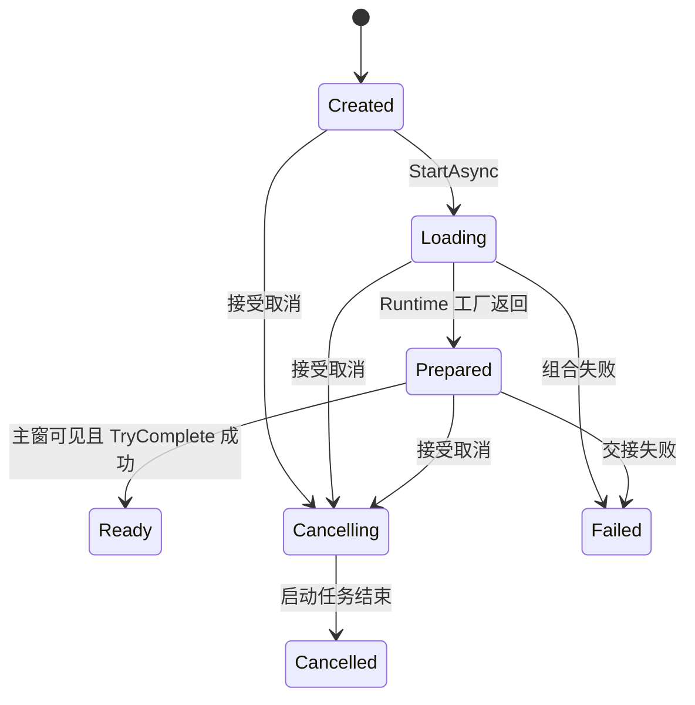

# 启动与组合：Prepared 为什么还不是 Ready

> 核对日期：2026-09-28。依据：当前实现与文中源码、契约、测试链接。

[上层：运行时](README.md) · [文档总览](../README.md)

## 概念和职责

| 对象 | 拥有的事实 |
| --- | --- |
| Program | 进程入口、诊断会话、重启交接、最终退出码 |
| StartupCoordinator | 单次启动任务、取消意图、原始失败、启动状态 |
| StartupWorker | Windows 专属启动线程的执行安排 |
| HostRuntime | Host Provider 与协作者的建立、工作台附接、关闭入口 |
| StartupDesktopShell | Splash、UI 进度刷新、主窗交接和失败窗口 |
| App | 轻量资源与正式资源安装、桌面生命周期转交 |

这是主要状态路径；Fail 也可以记录展示阶段的失败，实际转移以代码为准。Ready 后的用户关闭走主工作台协议，不再使用启动取消。

## 按组合顺序读代码

[HostRuntime.CreateAsync](../../../Host/MyAvaloniaManagement/Business/Composition/HostRuntime.cs) 先建立 ServiceCollection、RegistryBuilder、ProviderOwner、ScopeRegistry 和 ShutdownParticipants，再注册 Host 服务与 ViewModel。注册工厂只定义解析规则，不意味着所有对象已经实例化。

接着读取启用设置和发现快照，注册运行事实及窄端口，构建开启作用域验证的 Host Provider。各插件随后独立 Configure、构建 Provider、冻结贡献，经过冲突处理形成 Registry。命令目录与 Workflow 目录校验完成后，才初始化插件生命周期。

AttachWorkbench 是 UI 边界：安装完整资源、解析正式命令执行绑定和 Workspace 依赖，交给桌面 Shell 建立主窗口。不能把需要 Avalonia UI 线程的解析提前挪到后台组合。

## 为什么需要两阶段交接

后台组合成功只说明 Runtime 已经形成。资源加载、窗口构建或布局恢复仍可能失败。StartupDesktopShell 等待窗口 Show，并检查可见性和 TryComplete，随后确认安装试启动并关闭 Splash。因此 Prepared 和 Ready 分别对应对象图准备与 UI 交接。

[StartupCoordinator.RunAsync](../../../Host/MyAvaloniaManagement/Business/Startup/StartupCoordinator.cs) 即使在取消期间收到 Runtime，也先保存引用，确保 Program 最终能够关闭它。它不会把迟到成功覆盖到已提交的 Failed 状态。

## DI 代码怎样读

[ServiceCollectionExtensions](../../../Host/MyAvaloniaManagement/Business/Composition/ServiceCollectionExtensions.cs) 按职责分成注册方法。关注三件事：具体实例由谁 new；接口映射是否复用同一实例；哪些 DI 工厂在交付对象后登记 ShutdownParticipants。普通 AddSingleton 不需要额外的架构接口，只有真实跨边界端口才承担隔离责任。

## 线程与失败

Program 在 Windows 启动工作线程同步桥接安装准备，是为了保持之后模块首次构造/Configure 的 STA 入口；它不占用首屏 UI 线程。该契约不保证插件每个 await 后都回到同一 STA 线程。

单插件可隔离错误允许其他插件继续；组合致命错误进入失败展示和共用回滚。不能仅根据日志数量判断启动终态。

依据：[StartupDesktopShell](../../../Host/MyAvaloniaManagement/Business/Presentation/StartupDesktopShell.cs)、[StartupWorker](../../../Host/MyAvaloniaManagement/Business/Startup/StartupWorker.cs)、[启动契约](../../reference/host-startup.md)。测试入口：[StartupCoordinatorTests](../../../Host/MyAvaloniaManagement.Tests/StartupCoordinatorTests.cs)、[StartupPluginProgressTests](../../../Host/MyAvaloniaManagement.PluginTests/StartupPluginProgressTests.cs)、[StartupSplashUiTests](../../../Host/MyAvaloniaManagement.UiTests/StartupSplashUiTests.cs)。
