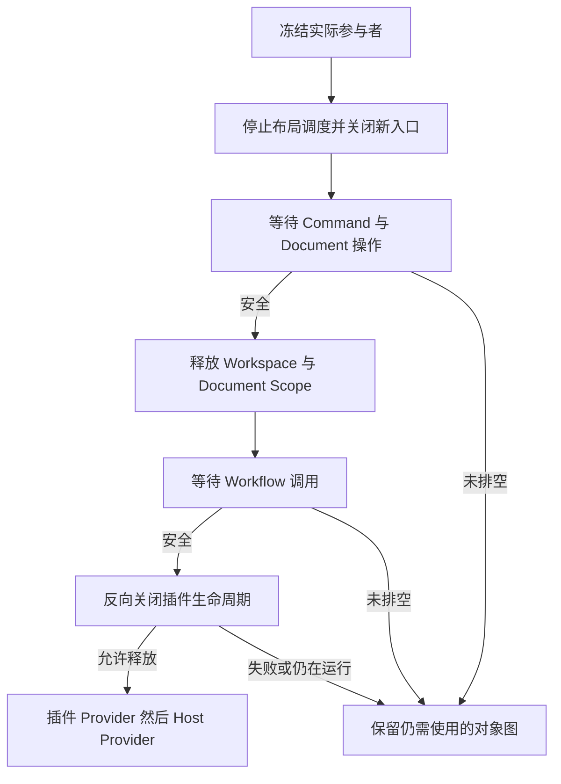

# 关闭与回滚：先证明可以释放

> 核对日期：2026-09-28。依据：当前实现与文中源码、契约、测试链接。

[上层：运行时](README.md) · [文档总览](../README.md)

## 关闭依赖

图表达主要先后约束。实际实现会继续尝试可以安全执行的收尾，并汇总失败；它不是遇到任一错误就立即跳出的单一路径。

## 核心类与方法

[HostRuntimeShutdown.RunAsync](../../../Host/MyAvaloniaManagement/Business/Composition/HostRuntimeShutdown.cs) 在锁内先发布共享完成任务，然后在锁外执行清理。并发或重复关闭看到同一 Task，避免执行两套 Dispose。

CompleteAsync 首先 Freeze ShutdownParticipants。这个快照只包含已成功交付的协作者；启动失败回滚时不会通过 GetRequiredService 临时创建一个此前没有存在过的 Workspace。

随后分别调用 Workflow、Command、可用状态、Workspace 和 Document 的 BeginShutdown。使用累计的安全标记，使一个入口关闭失败不会阻止其他入口撤销，同时阻止不安全的 Provider 释放。

## 三类“等待”不能互相替代

| 等待对象 | 原因 |
| --- | --- |
| Workbench Command | Handler 可能仍访问当前页面模型和 Scope |
| DocumentOperationGate | 功能中心或其他入口的初始化不一定经过命令执行器 |
| Workflow Action | Handler 在插件 Provider 的独立调用 Scope 内运行 |

Command 与 Document 排空后可以处理 Workspace 和文档 Scope。Workflow 也排空后，才有条件关闭插件生命周期并释放插件容器。仅关闭窗口不足以证明后台初始化已结束。

## 保留机制

[HostResourceRetention](../../../Host/MyAvaloniaManagement/Business/Composition/HostResourceRetention.cs) 保存无法安全释放的必要对象图直到进程退出。它不是重试框架或全局服务定位器。返回结果包含 ResourcesRetained、Failures 和生命周期关闭结论，Program 据此形成失败退出码。

取消令牌已触发、超时已返回、窗口已消失，都不能证明业务代码已经停止。某个插件同步阻塞在回调或 Dispose 中，也不受普通异步等待超时完整约束。

## 失败时保护原始事实

启动失败和正常退出复用此流程，但启动失败仍应保留原始异常。清理失败增加诊断，不覆盖最初原因。生命周期诊断出口在日志会话结束前关闭，避免迟到报告访问已释放日志。

修改此代码时，重点看所有权交接和调用是否排空，不要仅简化成“逆序 Dispose 所有字段”。验证入口：[HostLifecycleOwnershipTests](../../../Host/MyAvaloniaManagement.PluginTests/HostLifecycleOwnershipTests.cs)、[DocumentOperationShutdownTests](../../../Host/MyAvaloniaManagement.Tests/DocumentOperationShutdownTests.cs)、[WorkbenchCommandShutdownGateTests](../../../Host/MyAvaloniaManagement.Tests/WorkbenchCommandShutdownGateTests.cs)、[WorkflowActionShutdownGateTests](../../../Host/MyAvaloniaManagement.Tests/WorkflowActionShutdownGateTests.cs)。
