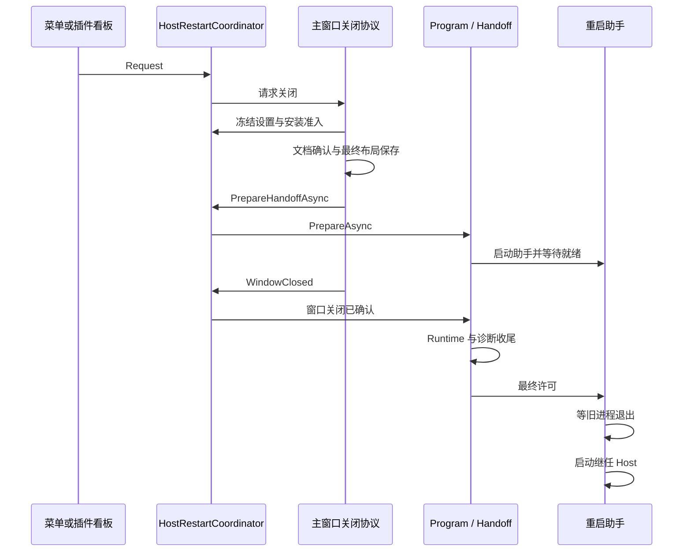

# 自动重启：请求、许可和跨进程交接

> 核对日期：2026-09-28。依据：当前实现与文中源码、契约、测试链接。

[上层：运行时](README.md) · [文档总览](../README.md)

## 为什么需要助手

旧 Host 仍可能加载插件 DLL、持有文件锁或执行关闭任务。重启不能在点击菜单时直接拉起新进程。旧进程完成窗口关闭与最终收尾，助手再确认旧进程真正退出，才能启动一次继任者。

## 三个所有者

HostRestartCoordinator 保存单次请求状态，借用设置与安装冻结租约；它不释放 Runtime。主窗口拥有文档和布局关闭许可。Program 持有 RestartHandoffSession，使其寿命长于 DI 容器释放。

[Request](../../../Host/MyAvaloniaManagement/Business/Restart/HostRestartCoordinator.cs) 首先 Validate 启动信息，再触发既有关闭入口。BeginPreparationAsync 冻结设置和安装准入并等待已接受操作；PrepareHandoffAsync 则在关闭准备通过后使助手就绪。

## 可撤销边界

在主窗口最终关闭前，用户取消文档关闭、设置等待失败或助手握手失败，都应撤销本次重启并恢复相应入口。关闭之后不再让 Coordinator 恢复旧工作区，最后交接由 Program 决定。

助手参数在 [Program](../../../Host/MyAvaloniaManagement/Program.cs) 最早分流，早于正常日志、插件发现和 Avalonia 工作台初始化。助手不执行插件安装事务，安装仍由下一次正常启动的安装会话完成。

## 代码阅读顺序

1. [HostRestartCoordinator](../../../Host/MyAvaloniaManagement/Business/Restart/HostRestartCoordinator.cs)：用户意图和窗口协议。
2. [RestartHandoffSession](../../../Host/MyAvaloniaManagement/Business/Restart/RestartHandoffSession.cs)：旧进程交接寿命。
3. [RestartHelperRunner](../../../Host/MyAvaloniaManagement/Business/Restart/RestartHelperRunner.cs)：助手等待与启动。
4. [HostLaunchSpecification](../../../Host/MyAvaloniaManagement/Business/Restart/HostLaunchSpecification.cs)：捕获可复用启动信息。

协议与支持边界以[重启契约](../../reference/host-restart.md)为准。测试入口：[HostRestartTests](../../../Host/MyAvaloniaManagement.Tests/HostRestartTests.cs)、[HostRestartHandoffTests](../../../Host/MyAvaloniaManagement.Tests/HostRestartHandoffTests.cs)、[HostRestartProcessTests](../../../Host/MyAvaloniaManagement.PluginTests/HostRestartProcessTests.cs)。
