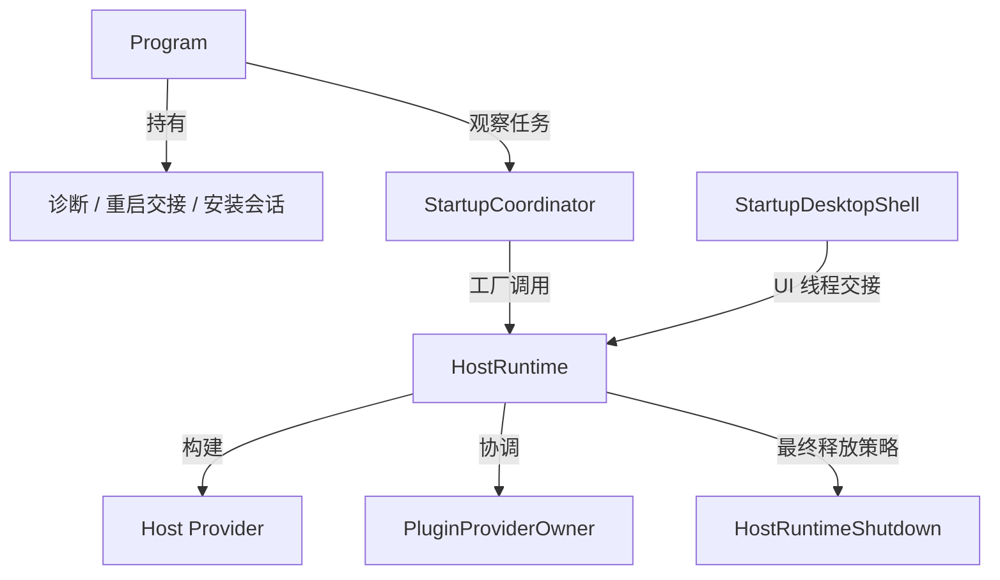

# 运行时：组合、启动、退出与重启

> 核对日期：2026-09-28。依据：当前实现与文中源码、契约、测试链接。

[返回文档总览](../README.md)

## 模块定位

运行时把各模块装配成一个可启动、可关闭的应用。它拥有组合顺序和最终释放决策；UI Shell 拥有窗口适配；各业务模块分别证明自己的任务能否结束。

## 阅读顺序

1. [启动与组合](01-startup-and-composition.md)：从首屏到 Ready，以及 DI 组合。
2. [关闭与失败回滚](02-shutdown-and-rollback.md)：何时可以释放，何时必须保留。
3. [自动重启](03-restart-handoff.md)：窗口许可、进程收尾和助手协议。

代码起点为 [Program](../../../Host/MyAvaloniaManagement/Program.cs) 与 [HostRuntime](../../../Host/MyAvaloniaManagement/Business/Composition/HostRuntime.cs)。插件初始化细节继续进入[插件生命周期](../02-plugins/03-lifecycle-and-availability.md)。

## 本模块最重要的不变量

一个 Runtime 对应一组明确所有者。对象别名或接口映射不创建第二份所有权；失败清理只处理实际建立的对象；取消是意图，释放要求实际任务结束。正常退出与启动回滚使用相同的收尾原则。
