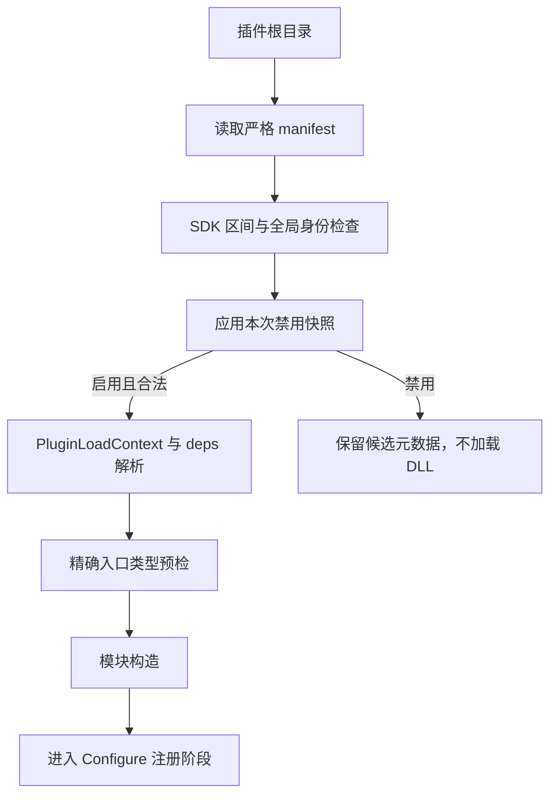

# 发现与加载：先识别，再执行插件代码

> 核对日期：2026-09-28。依据：当前实现与文中源码、契约、测试链接。

[上层：插件体系](README.md) · [文档总览](../README.md)

## 从目录到模块的阶段

加载不是扫描所有类并寻找“看起来像插件”的类型。清单给出唯一入口；Host 根据完整名称预检具体 public 类型、模块接口和无参构造。其他类不会因为实现类似接口自动获得入口资格。

## 关键协作者

| 代码 | 责任 |
| --- | --- |
| [AssemblyLoaderHelper](../../../Host/MyAvaloniaManagement/Business/Plugins/Discovery/AssemblyLoaderHelper.cs) | 建立并缓存发现快照，组织清单和程序集阶段 |
| [PluginManifest](../../../Host/MyAvaloniaManagement/Business/Plugins/Discovery/PluginManifest.cs) | 运行清单格式与声明 |
| [PluginLoadContext](../../../Host/MyAvaloniaManagement/Business/Plugins/Discovery/PluginLoadContext.cs) | 每插件依赖解析上下文 |
| [PluginSharedAssemblyPolicy](../../../Host/MyAvaloniaManagement/Business/Plugins/Discovery/PluginSharedAssemblyPolicy.cs) | 确定哪些契约和 UI 类型与 Host 共享 |
| [PluginModulePreflight](../../../Host/MyAvaloniaManagement/Business/Plugins/Discovery/PluginModulePreflight.cs) | 不构造模块的类型预检 |
| [PluginModuleCatalog](../../../Host/MyAvaloniaManagement/Business/Plugins/Discovery/PluginModuleCatalog.cs) | 从已确认入口构造模块候选 |

## ALC 与 DI 隔离有什么不同

ALC 解决程序集身份及依赖版本解析；Provider 解决实例解析及释放。两个插件可以拥有同名私有依赖的不同版本，但 SDK 类型必须与 Host 对齐，否则接口看起来同名也不是同一个运行时类型。

入口需要相应 deps 文件，托管与原生依赖按依赖图解析。Host 不注册进程级 AssemblyResolve 来替插件兜底，这避免一个插件解析行为影响整个进程。

## 快照和缓存

发现结果按插件根和数据根隔离，并保留首次启动策略。运行期间修改启用设置不会让缓存重新加载程序集。这个缓存模型与“通过重启应用插件变更”的交付方式一致；它不是文件系统实时监控。

单个目录的清单、依赖或类型错误通常进入该候选诊断，其他独立候选可继续。应进一步根据诊断 disposition 判断是隔离插件还是终止启动，不能把所有异常统一吞掉。

## 读代码时验证

先看 Discover 阶段的顺序，再看 PluginLoadContext 的共享判断，最后看模块构造。特别检查禁用过滤是否发生在创建 ALC 和执行插件代码之前。

测试入口：[CurrentManagedPluginLoadingTests](../../../Host/MyAvaloniaManagement.PluginTests/CurrentManagedPluginLoadingTests.cs)、[PluginDependencyIsolationTests](../../../Host/MyAvaloniaManagement.PluginTests/PluginDependencyIsolationTests.cs)、[PluginManifestCompatibilityTests](../../../Host/MyAvaloniaManagement.PluginTests/PluginManifestCompatibilityTests.cs)、[PluginEnablementLoadingTests](../../../Host/MyAvaloniaManagement.PluginTests/PluginEnablementLoadingTests.cs)。下一层：[注册](02-registration-and-containers.md)。
