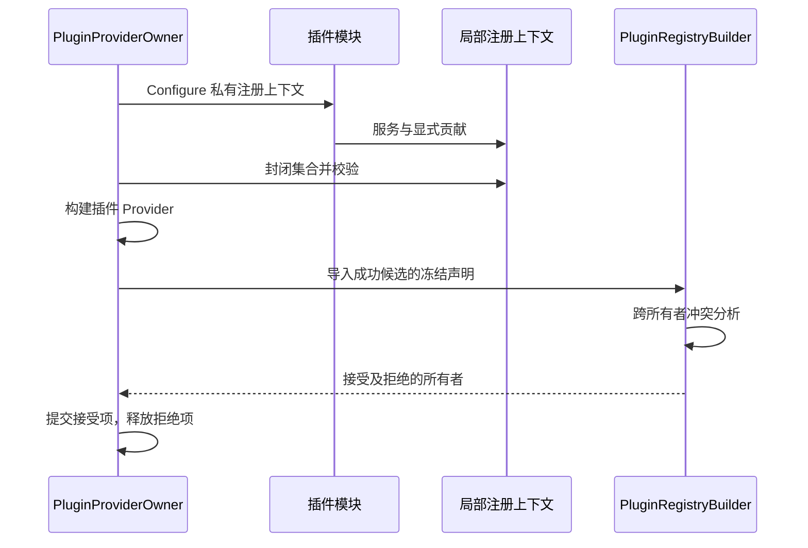
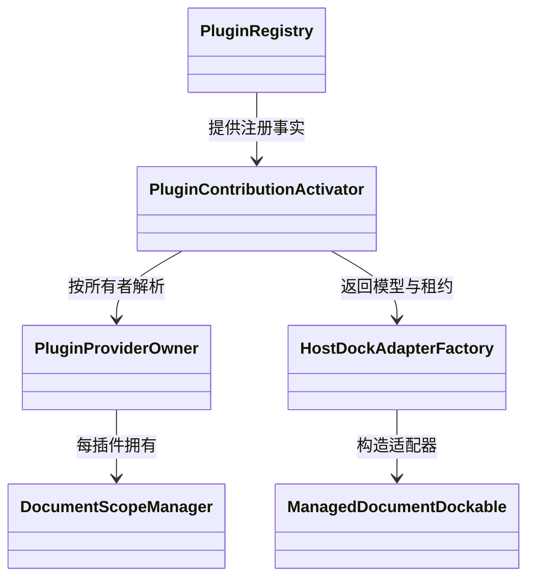

# 注册与容器：声明提交和实例激活分开

> 核对日期：2026-09-28。依据：当前实现与文中源码、契约、测试链接。

[上层：插件体系](README.md) · [文档总览](../README.md)

## 局部声明如何成为全局事实

## 私有 Provider 保护什么

每个插件收到全新 ServiceCollection，不包含 Host 的服务描述符。Document、Tool、View、Lifecycle 等通过专用注册方法表达。普通服务注册只留在当前插件容器，不能凭一个 AddSingleton 自动成为工作台贡献。

Configure 返回后，贡献入口和插件保存的 Services 引用都被封闭。PluginServiceCommitGuard 检查保留 Host 端口和贡献根的影子注册，随后 Host 追加固定端口及 Scope 基础设施。

## 局部和全局两道校验

[PluginContributionValidator](../../../Host/MyAvaloniaManagement/Business/Plugins/Registration/PluginContributionValidator.cs) 检查一个所有者内部的声明一致性；[PluginConflictAnalyzer](../../../Host/MyAvaloniaManagement/Business/Plugins/Registration/PluginConflictAnalyzer.cs) 检查多个候选间的冲突。它们只消费冻结数据，不创建 View 或解析业务模型。

重复 ID、重复精确模型映射、所有者混入等不能仅删除冲突的一行后继续交付剩余半插件。冲突治理以候选所有者为边界；与 Host 内建项冲突时保留 Host，无冲突插件继续。具体诊断及集合处理读 RegistryBuilder.Build。

## 提交后如何创建对象

图中 Activator 到 AdapterFactory 表示结果被后者消费，不是 Registry 发起模型创建。Document 通过所属 ScopeManager 创建，Tool 从所属 Provider 解析单例；Host 贡献走 Host 激活路径。AdapterFactory 负责把普通模型和精确 View 包装为内部 Dock Adapter。

Registry 不保存 Provider。这样元数据查询不会意外解析业务依赖，释放职责也不会散落到只读目录里。

## 源码阅读顺序与风险

读 [PluginProviderOwner.Compose / CommitRegistryResult](../../../Host/MyAvaloniaManagement/Business/Plugins/Registration/PluginProviderOwner.cs)，再读 [PluginRegistryBuilder](../../../Host/MyAvaloniaManagement/Business/Plugins/Registration/PluginRegistryBuilder.cs)，最后读 [PluginContributionActivator](../../../Host/MyAvaloniaManagement/Business/Plugins/Registration/PluginContributionActivator.cs)。

改动要检查失败 Provider 是否释放、Scope 所有者是否只在接受后登记、模块保留的集合引用是否仍可修改。验证入口：[PluginContainerIsolationTests](../../../Host/MyAvaloniaManagement.PluginTests/PluginContainerIsolationTests.cs)、[PluginRegistrationOwnershipTests](../../../Host/MyAvaloniaManagement.Tests/PluginRegistrationOwnershipTests.cs)、[PluginConflictAnalyzerTests](../../../Host/MyAvaloniaManagement.Tests/PluginConflictAnalyzerTests.cs)。
