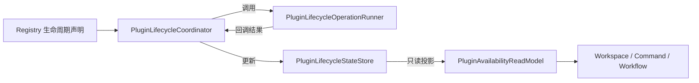

# 生命周期与可用性：注册成功之后仍有运行阶段

> 核对日期：2026-09-28。依据：当前实现与文中源码、契约、测试链接。

[上层：插件体系](README.md) · [文档总览](../README.md)

## 声明事实和运行状态

Registry 表示合法贡献已经提交；PluginLifecycleStateStore 表示插件处于什么运行阶段。没有生命周期贡献的插件也不能靠 UI 随意推断可用性，应通过统一的可用性读模型查询。页面和命令使用这个读模型过滤或拒绝操作。

## 初始化与停止的次序

Coordinator 按 PluginId 确定性初始化，记录每次尝试和成功启动的位置。退出时反向处理应停止的项。失败回滚也遵守记录，而不是扫描当前 DI 容器重新猜测哪些生命周期已经执行。

默认初始化期限为 30 秒，停止期限为 10 秒，首次请求取消后有固定 2 秒宽限。数值属于 Host internal 政策，可由测试注入更短期限；详细逻辑看 PluginLifecycleTimeouts 和 OperationRunner。

## 为什么要分别跟踪回调与取消通知

插件生命周期 Task 完成不一定意味着 CancellationToken 回调也完成。取消处理器可能执行用户代码，也可能抛出异常。因此 OperationRunner 跟踪回调任务、取消通知任务和 CTS，只有满足安全条件才允许容器释放。

迟到初始化按照原始启动位置处理，越过关闭位置后不会重新插入一轮停止。Shutdown 失败或取消的保守保留政策与“任务仍在运行”是不同原因，诊断需能区分。

## 失败与 UI 的关系

可用性改变会影响创建目录、命令和工具状态。插件看板聚合 Registry、候选、生命周期及诊断；它本身不执行生命周期，也不通过改变一行显示来启用插件。

当前生命周期不是热卸载协议。撤回可用性不代表可以卸载 ALC，也不代表 DLL 可以在运行中替换。

源码：[PluginLifecycleCoordinator](../../../Host/MyAvaloniaManagement/Business/Lifecycle/PluginLifecycleCoordinator.cs)、[OperationRunner](../../../Host/MyAvaloniaManagement/Business/Lifecycle/PluginLifecycleOperationRunner.cs)、[StateStore](../../../Host/MyAvaloniaManagement/Business/Lifecycle/PluginLifecycleStateStore.cs)。测试：[PluginLifecycleCoordinatorTests](../../../Host/MyAvaloniaManagement.PluginTests/PluginLifecycleCoordinatorTests.cs)、[HostLifecycleOwnershipTests](../../../Host/MyAvaloniaManagement.PluginTests/HostLifecycleOwnershipTests.cs)。继续：[Runtime 收尾](../01-runtime/02-shutdown-and-rollback.md)。
