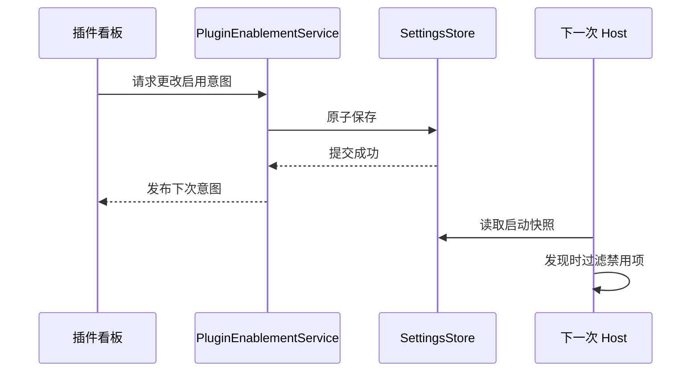

# 插件启用设置：当前事实与下次意图

> 核对日期：2026-09-28。依据：当前实现与文中源码、契约、测试链接。

[上层：插件体系](README.md) · [文档总览](../README.md)

## 两份信息必须分开

| 信息 | 所有者 | 何时变化 |
| --- | --- | --- |
| 本次启动候选及禁用过滤结果 | PluginDiscoverySnapshot | 本次发现时冻结 |
| 已保存的下次启动意图 | PluginEnablementService / Store | 设置文件成功提交后 |
| 当前生命周期可用性 | 生命周期状态与读模型 | 初始化、故障、关闭 |
| 是否需要重启 | 上述事实比较的投影 | 保存或运行状态变化后 |

保存失败时不提前改变成功状态。本次已经加载的插件继续沿原生命周期运行，不能把“下次禁用”实现为立即销毁模型。

## 并发、窗口关闭和重启

设置用例属于 Runtime 服务，窗口只负责发起请求与展示。关闭看板应退订 UI 通知，但不撤销服务已经接受的保存。迟到回调必须检查展示对象寿命。

自动重启通过 IPluginEnablementRestartBarrier 冻结新设置操作，并等待已接受写入完成；若关闭取消，则释放冻结租约恢复入口。这里不是取消文件写入后强行继续重启。

## 代码解析入口

[PluginEnablementSettingsStore](../../../Host/MyAvaloniaManagement/Business/Plugins/Enablement/PluginEnablementSettingsStore.cs) 管严格读写，[PluginEnablementService](../../../Host/MyAvaloniaManagement/Business/Plugins/Enablement/PluginEnablementService.cs) 管意图、准入和通知，[PluginStatusQuery](../../../Host/MyAvaloniaManagement/Business/PluginStatus/PluginStatusQuery.cs) 汇合多种事实。

修改此流程时，先确定字段表达的是哪条时间线；避免同一个布尔值同时代表“保存意图”和“当前可用”。当前格式及用户行为见[启用契约](../../reference/plugin-enablement.md)。

验证入口：[PluginEnablementServiceTests](../../../Host/MyAvaloniaManagement.Tests/PluginEnablementServiceTests.cs)、[PluginEnablementRestartTests](../../../Host/MyAvaloniaManagement.PluginTests/PluginEnablementRestartTests.cs)、[PluginEnablementUiTests](../../../Host/MyAvaloniaManagement.UiTests/PluginEnablementUiTests.cs)。
