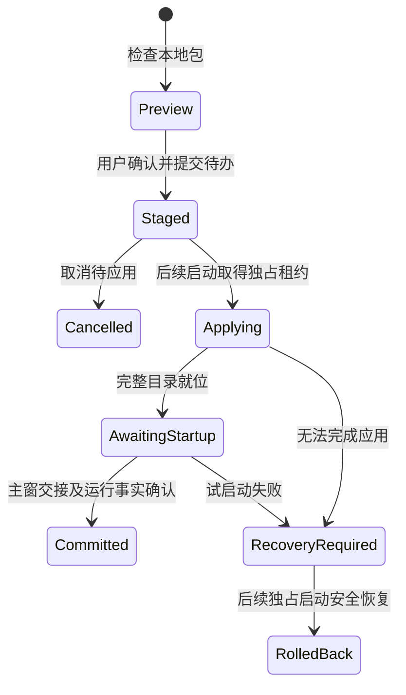

# 本地 ZIP 安装：预览、事务日志与下次启动恢复

> 核对日期：2026-09-28。依据：当前实现与文中源码、契约、测试链接。

[上层：插件体系](README.md) · [文档总览](../README.md)

## 两个进程阶段

当前 Host 运行期间，安装服务只检查候选、形成预览并提交待应用操作。真正替换插件目录发生在后续正常启动的插件发现之前。安装助手与重启助手是不同职责：重启助手只负责进程交接。

Preview 是内存用例阶段，不是持久日志枚举。状态图省略进程中断、占用和摘要冲突的具体恢复分支；日志阶段与事实核对规则以实现和安装契约为准。

## 内部分工

| 类型 | 责任 |
| --- | --- |
| PluginPackageInspector / PluginPayloadValidator | 复制输入快照、受限解包、静态校验 |
| PluginReleaseManifest | 配套清单的完整性与摘要核对 |
| PluginInstallPlanner | PluginId、版本和目录目标的纯决策 |
| PluginInstallationService | 预览、提交、取消、恢复预览和后台任务所有权 |
| PluginInstallationStore / FileCommit | 严格记录、原子写入与可注入实际文件步骤 |
| PluginInstallApplier | 完整目录替换、确认及幂等恢复 |
| PluginInstallationSession / Lease | 进程入口接线和插件根租约 |

## 一次更新的提交边界

InspectAsync 先复制 ZIP 到安装暂存根，后续操作使用该快照。CommitAsync 重新核对摘要与磁盘基线，提交 Staged。文件预览通过不等于已执行插件，更不等于业务兼容。

后续启动 PrepareAsync 取得允许修改的租约后，Applier 先写恢复意图，再把旧目录移到备份，把完整候选移动到目标。它不把新旧目录逐文件混合。AwaitingStartup 记录试运行进程身份，真实启动成功才确认。

安装登记和操作日志不是同一原子文件，最终成功日志是提交标志。中断后依据日志、前后摘要、备份与旧登记恢复，不能单看“目标目录存在”就宣布成功。

## 进程锁与恢复

运行期共享租约持续到 ProcessExit，避免 Runtime 已关闭但原生线程或延迟加载仍使用 DLL。锁顺序为 runtime 到 operations；当前会话准备待办不升级运行锁。其他实例占用时保留待办并允许合规的旧版运行。

已经加载失败的新 DLL 不在当前进程换回。当前进程记录恢复要求，下次独占启动恢复原目录。未知内容、坏备份或基线冲突应保留现场，不能盲目覆盖。

启用偏好、文档和布局不由安装器迁移；插件业务数据也不是目录备份可以自动迁移的内容。详细路径、字节限制、检查级别见[安装契约](../../reference/plugin-installation.md)。

## 源码与测试

从 [InstallationService](../../../Host/MyAvaloniaManagement/Business/Plugins/Installation/PluginInstallationService.cs) 的 InspectAsync、CommitAsync 读到 [InstallApplier](../../../Host/MyAvaloniaManagement/Business/Plugins/Installation/PluginInstallApplier.cs) 的 ApplyAsync、RecoverAsync、ConfirmAsync，再回到 [InstallationSession](../../../Host/MyAvaloniaManagement/Business/Plugins/Installation/PluginInstallationSession.cs) 理解租约寿命。

测试入口：[PluginInstallPlannerTests](../../../Host/MyAvaloniaManagement.Tests/PluginInstallPlannerTests.cs)、[PluginPackageInstallationTests](../../../Host/MyAvaloniaManagement.PluginTests/PluginPackageInstallationTests.cs)、[PluginInstallationTransactionTests](../../../Host/MyAvaloniaManagement.PluginTests/PluginInstallationTransactionTests.cs)、[PluginInstallationProcessTests](../../../Host/MyAvaloniaManagement.PluginTests/PluginInstallationProcessTests.cs)。
