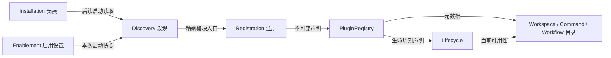

# 插件体系：从磁盘文件到可用能力

> 核对日期：2026-09-28。依据：当前实现与文中源码、契约、测试链接。

[返回文档总览](../README.md)

## 模块地图

这里有三条时间线：磁盘已安装版本、本次进程加载事实、下次启动意图。插件看板可以同时展示它们，但不能把一次设置保存当作当前运行状态已经改变。

## 逐层阅读

1. [发现与加载](01-discovery-and-loading.md)：清单、程序集、共享依赖、精确入口。
2. [注册与私有容器](02-registration-and-containers.md)：声明冻结、冲突、所有者与激活。
3. [生命周期与可用性](03-lifecycle-and-availability.md)：初始化、取消、关闭和资源保留。
4. [启用设置](04-enablement.md)：本次事实与下次意图。
5. [本地安装与恢复](05-installation-and-recovery.md)：预览、待办、独占应用和试启动确认。

## 模块边界

Registry 保存“谁声明了什么”，ProviderOwner 保存“从哪个容器取得实例”，Lifecycle 保存“现在是否可用”。Workspace 决定实例是否已经进入工作区。把这些事实分开，可以让读取目录不触发插件实例创建，也让禁用、失败和未安装成为可区分的状态。

详细协议继续引用[启用契约](../../reference/plugin-enablement.md)、[安装契约](../../reference/plugin-installation.md)和[SDK API 基线](../../reference/plugin-sdk-api-compatibility.md)。
