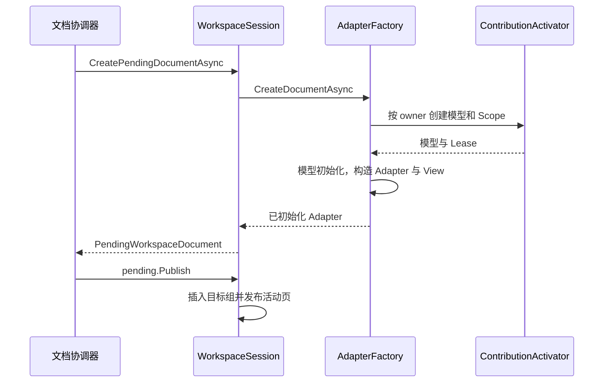

# 目录、会话与激活：五种角色的分工

> 核对日期：2026-09-28。依据：当前实现与文中源码、契约、测试链接。

[上层：工作区](README.md) · [文档总览](../README.md)

## 从只读事实进入实例世界

| 角色 | 输入 | 输出或状态 |
| --- | --- | --- |
| HostWorkspaceCatalog | Host 的显式贡献 | 内建页面和工具声明 |
| WorkspaceCatalog | Host 目录、PluginRegistry、可用性 | 当前可用注册查询 |
| PluginContributionActivator | 精确注册身份 | 普通模型及所属 Scope 租约 |
| HostDockAdapterFactory | 已激活模型、View 工厂 | 可发布 Adapter |
| WorkspaceSession | Adapter 与目标位置 | 已拥有、已发布、活动状态 |



## 所有与可见不是同一个提交点

Session 的 _ownedDocuments 记录它必须负责收尾的实例。实例可能已经完成初始化，但尚未插入 Dock，比如恢复备份还在等待用户确认。此时它仍需要明确释放责任。

[PendingWorkspaceDocument](../../../Host/MyAvaloniaManagement/Business/Workspace/PendingWorkspaceDocument.cs) 表达发布前的局部回滚义务。它不直接拥有模型或 IServiceScope：

```csharp
owner.PublishDocument(Document, target);
_workspace = null;
return Document;
```

上述源码片段的顺序很重要：只有 PublishDocument 返回成功，才清除回滚义务。若插入或通知失败，外层 using 退出仍会调用 Session 回滚。重复 Dispose 通过交换引用保持幂等。

## Session 内怎样提交

[CreateDocumentAsync](../../../Host/MyAvaloniaManagement/Business/Workspace/WorkspaceSession.cs) 先校验创建准入与激活形式，等待工厂，登记所有权和持久化状态。PublishDocument 在初始化完成后重新解析目标，确认同一实例未重复发布，插入后检查 Dock 是否接受，再发布活动变化和页面跟踪。

RollbackPendingDocument 先尝试撤销可能已插入的节点，再进入 ReleaseDocument。撤销与释放各自记录清理失败，避免清理异常覆盖原始初始化错误。

## 修改时的判断

如果需求改变“能创建什么”，看 Catalog；改变“如何构造业务对象”，看 Activator；改变“如何接入 Dock 和 View”，看 AdapterFactory；改变“何时可见、何时释放”，看 Session。不要让查询目录方法顺便创建模型。

源码：[WorkspaceCatalog](../../../Host/MyAvaloniaManagement/Business/Workspace/WorkspaceCatalog.cs)、[Session](../../../Host/MyAvaloniaManagement/Business/Workspace/WorkspaceSession.cs)、[AdapterFactory](../../../Host/MyAvaloniaManagement/Business/Docking/HostDockAdapterFactory.cs)。验证：[HostCatalogPluginRegistryTests](../../../Host/MyAvaloniaManagement.Tests/HostCatalogPluginRegistryTests.cs)、[WorkspaceSessionAndDockFactoryTests](../../../Host/MyAvaloniaManagement.Tests/WorkspaceSessionAndDockFactoryTests.cs)。
