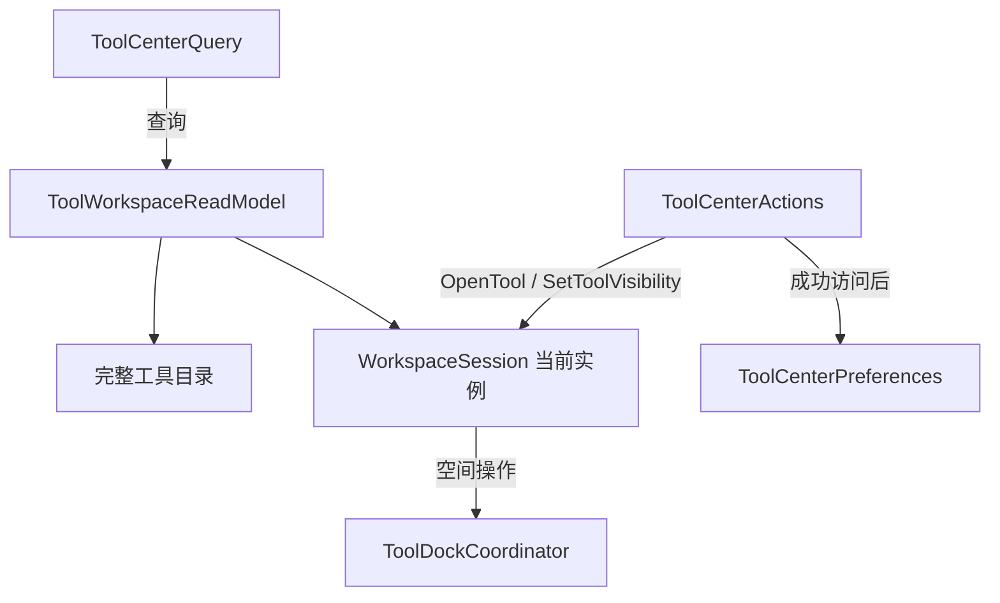

# 工具显隐：复用实例与空间位置恢复

> 核对日期：2026-09-28。依据：当前实现与文中源码、契约、测试链接。

[上层：工作区](README.md) · [文档总览](../README.md)

## Tool 的三份事实

注册目录说明工具是否存在；可用性说明所属插件是否可用；Session 与 Dock 树说明实例目前可见、隐藏、自动隐藏或浮动。工具中心必须组合这些信息，不能只遍历当前可见树，否则隐藏工具将无处找回。

## 三个入口的语义

OpenTool 表达“访问这个工具”：如果已经可见，仍需要定位或预览。SetToolVisibility 表达“使显隐达到某状态”：状态已满足时不产生额外副作用。HideAllTools 执行批量隐藏，保留逐项结果并合并最终通知。

这些入口先确认工具身份、当前可用性和已有实例，再由 ToolDockCoordinator 处理原位置恢复与 Dock 协议。不能在 UI 再造一条 ShowTool 分发链或直接改布局集合。

## 隐藏为什么不释放业务模型

ManagedToolDockable 拥有它的 View；模型是 Host 或插件 Provider 的 singleton。隐藏面板后，模型及其业务服务仍可继续工作。Session 退出释放 Adapter/View，Provider 最后释放模型。

工具恢复优先保留合法的位置关系；缺失结构需要按已有布局规则重建。最后一个 Tool 位于浮窗时，隐藏可能触发整窗关闭，必须尊重原生否决。失败不能更新活动项或报告“隐藏成功”。

## 偏好与布局分开

收藏、分类和最近访问保存在工具中心偏好中；Dock 树和窗口位置由 Layout 持久化。偏好文件不复制一份可变布局。成功操作才更新最近访问，避免失败点击污染记录。

源码：[ToolCenterActions](../../../Host/MyAvaloniaManagement/Business/ToolCenter/ToolCenterActions.cs)、[ToolWorkspaceReadModel](../../../Host/MyAvaloniaManagement/Business/Workspace/ToolWorkspaceReadModel.cs)、[ToolDockCoordinator](../../../Host/MyAvaloniaManagement/Business/Layout/ToolDockCoordinator.cs)、[WorkspaceSession](../../../Host/MyAvaloniaManagement/Business/Workspace/WorkspaceSession.cs)。验证：[ToolCenterTests](../../../Host/MyAvaloniaManagement.Tests/ToolCenterTests.cs)、[DockToolWindowCloseUiTests](../../../Host/MyAvaloniaManagement.UiTests/DockToolWindowCloseUiTests.cs)。
