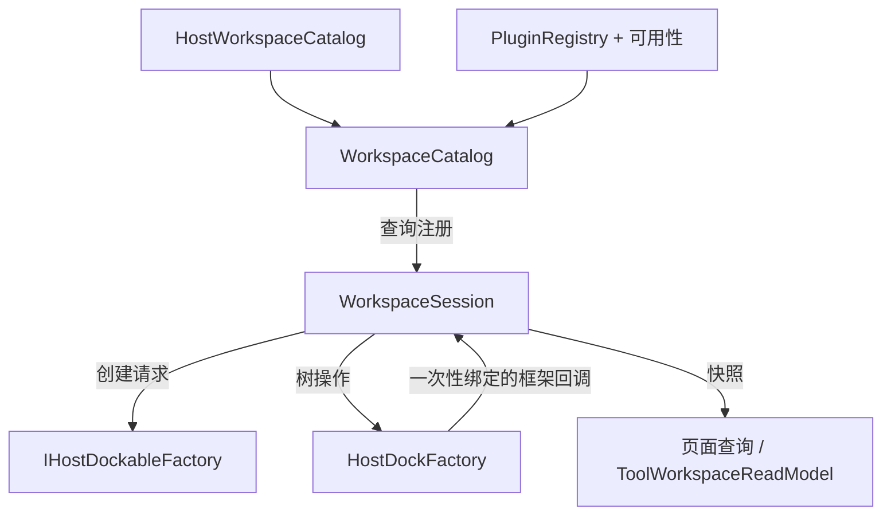

# 工作区：声明如何变成运行中的页面和工具

> 核对日期：2026-09-28。依据：当前实现与文中源码、契约、测试链接。

[返回文档总览](../README.md)

## 内部概念图

WorkspaceSession 拥有一个 Runtime 中的工作区，包括 Root、Document 区域、已拥有的文档及已创建工具。它不是 DI 服务定位器，也不解释文档 JSON。

## 阅读顺序

- [目录、会话和激活](01-catalog-session-activation.md)：声明、模型、Adapter 各处于什么阶段。
- [页面身份、活动目标与查询](02-pages-targets-and-queries.md)：跨窗口新建和命令路由依据什么。
- [工具显隐与恢复](03-tools-and-visibility.md)：隐藏为何不等于释放。

## 与相邻模块的边界

文档协调器选择文件、编排保存和恢复；Session 处理实例发布。Dock 适配器负责框架协议；Session 接收业务相关回调。布局生命周期管理文件和保存调度；Session 保持业务实例所有权。继续查看[创建机制](../04-documents/03-create-and-activate.md)和[Dock 适配](../05-docking-layout/01-adapters-and-views.md)。
