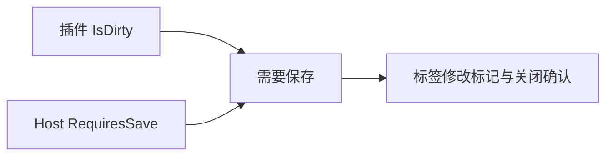

# 文档概念：激活、内容、修订和持久化状态

> 核对日期：2026-09-28。依据：当前实现与文中源码、契约、测试链接。

[上层：文档模块](README.md) · [文档总览](../README.md)

## 模型与宿主信息

| 事实 | 所有者 | 为什么这样分 |
| --- | --- | --- |
| 业务内容和内容 schema | 插件 Document | Host 不理解业务字段 |
| PluginId、DocumentTypeId | 规范 Registry | 不信任内容反向声明其归属 |
| 文件路径和磁盘标题 | Host 状态存储 | 查重、保存和恢复共享事实 |
| 内容修订 Revision | 插件保存快照 | 表达捕获时的稳定内容版本 |
| RequiresSave | Host | 恢复副本即使模型不脏也必须另存 |
| PageId 与窗口位置 | Workspace / Layout | 运行实例和呈现位置不属于业务文件 |

## 两种互斥激活

NewDocumentActivation 说明用户新建，包含创建意图；RestoreDocumentActivation 说明按已有内容恢复，携带 DocumentContent。模型在一次 InitializeAsync 中接受明确激活形式，Host 不靠一串可空参数猜测“这是新建还是恢复”。

DocumentContent 包含插件内容版本与 JSON payload。DocumentSaveSnapshot 同时提供内容及修订，使保存确认知道自己确认的是哪一版。精确契约见 [DocumentContracts](../../../Host/MyAvaloniaManagement.PluginSdk/DocumentContracts.cs)。

## Dirty 不只来自插件

[DocumentPersistenceStateStore.IsDirty](../../../Host/MyAvaloniaManagement/Business/Documents/DocumentPersistenceStateStore.cs) 合并这两个来源。恢复的内容可能是完整且自洽的，插件认为不脏，但 Host 仍要求另存以保护损坏原件。

保存后 AcceptChanges(savedRevision) 是让插件确认那一版内容。保存过程中若产生更新修订，插件不应清除新修改。保存成功和当前已经干净因此不是等价状态。

## 身份和标题的三个用途

类型身份用于从目录查到模型和所有者；路径身份用于激活已打开文件；PageId 用于定位当前运行页面。显示标题面向用户，不可作为唯一键。

Host 提交磁盘标题后优先使用该标题；尚未提交时 Adapter 可以从模型呈现信息、激活请求和描述符回退。标题变化不改变文档类型或文件归属。

## 最小阅读实验

跟踪一个新页面：先观察 Registry 注册，再观察独立模型实例，最后观察 Session 发布后的 PageId。保存后新增路径事实，但实例和 Scope 不变。把页面浮动到另一窗口，改变的是布局归属，同样不应产生新模型。

验证：[IdentityAndRegistryTests](../../../Host/MyAvaloniaManagement.Tests/IdentityAndRegistryTests.cs)、[DocumentEnvelopeV2Tests](../../../Host/MyAvaloniaManagement.Tests/DocumentEnvelopeV2Tests.cs)、[DocumentPersistenceTests](../../../Host/MyAvaloniaManagement.Tests/DocumentPersistenceTests.cs)。
