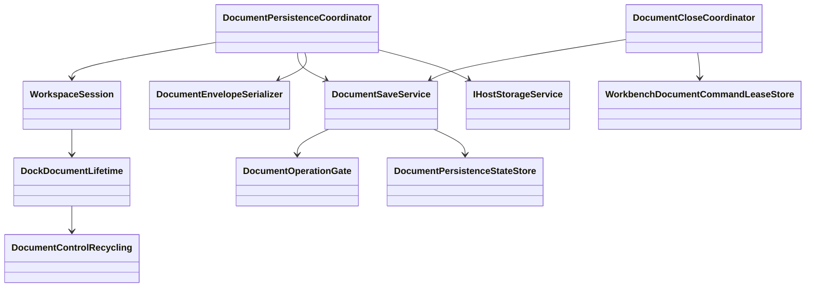

# 文档内部结构：协调器、状态与资源所有者

> 核对日期：2026-09-28。依据：当前实现与文中源码、契约、测试链接。

[上层：文档模块](README.md) · [文档总览](../README.md)

## 局部类型关系

这是关键依赖子集；省略的构造参数可从源码核对。箭头表示使用，不表示被使用对象的寿命属于调用者。

## 分工表

| 协作者 | 负责 | 状态或提交点 |
| --- | --- | --- |
| PersistenceCoordinator | 新建、选择文件、逐个打开、恢复及活动保存 | 返回 DocumentOperationResult |
| SaveService | 单个已确定 Document 的保存 | 主文件写入成功 |
| CloseCoordinator | 是否允许标签或范围关闭 | 一次性许可与最终脏状态检查 |
| OperationGate | 串行准入和退出排空 | 接受/排队/运行的请求计数 |
| PersistenceStateStore | 规范注册、路径、标题、RequiresSave | CommitFile / MarkRecovered |
| RecoveryRegistry | 恢复副本对应的原件和备份 | 恢复登记与保存后清除 |
| OperationState | Host 唯一文档错误条 | Apply 操作结果 |
| ScopeManager | 模型与独立 Scope 的绑定 | 创建登记及最终释放 |

## 为什么结果不直接修改所有界面

Coordinator 返回是否更新错误提示、消息以及新页面身份。文件命令、文件树和功能入口可以根据同一结果更新 OperationState，不需要每个 ViewModel 单独保存一份业务错误。

Scope 不归 Coordinator，JSON 不归 Session，关闭确认不归 SaveService。这样保存可以被菜单和关闭共用，创建失败也能使用 Workspace 已有的统一回滚。

## 代码阅读路径

从 [DocumentPersistenceCoordinator](../../../Host/MyAvaloniaManagement/Business/Documents/DocumentPersistenceCoordinator.cs) 的构造参数开始，将依赖按“工作区、文件、交互、状态、串行门”分类；接着读 [DocumentSaveService](../../../Host/MyAvaloniaManagement/Business/Documents/DocumentSaveService.cs) 的保存提交；最后读 [DocumentCloseCoordinator](../../../Host/MyAvaloniaManagement/Business/Documents/DocumentCloseCoordinator.cs)，理解它如何消费保存结果而不重写保存。

模型创建与 View 的细节继续到[创建机制](03-create-and-activate.md)，最终释放到[所有权](07-ownership-and-concurrency.md)。测试总导航见[本模块代码与测试](08-code-and-tests.md)。
