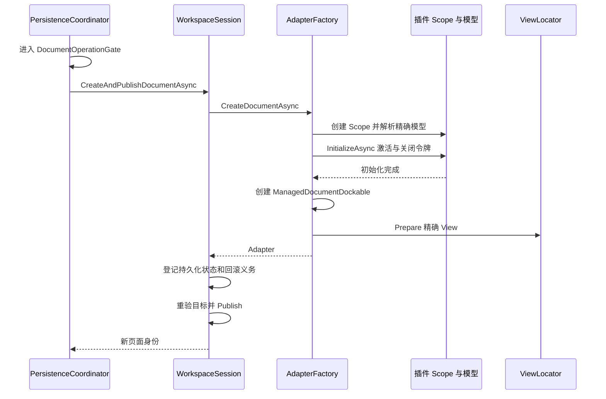

# 创建与激活：成功初始化以后才让页面可见

> 核对日期：2026-09-28。依据：当前实现与文中源码、契约、测试链接。

[上层：文档模块](README.md) · [文档总览](../README.md)

## 运行顺序



## 关键顺序的源码

[HostDockAdapterFactory.CreateDocumentAsync](../../../Host/MyAvaloniaManagement/Business/Docking/HostDockAdapterFactory.cs) 的核心原文：

```csharp
await activatedDocument.Model.InitializeAsync(
    activation,
    activatedDocument.ClosingToken);
adapter = new ManagedDocumentDockable(activatedDocument, activation.Title);
_viewLocator.Prepare(adapter);
return adapter;
```

模型初始化发生在 Adapter 和 View 构造之前。这样初始化失败时，不会出现一张已显示但内容未完成的页面。View 也在 Dock 发布前预构建，避免把 View 工厂异常延迟到框架渲染阶段。

## 从租约到发布义务

Activator 返回模型和 Scope 租约。Adapter 尚未建立时，工厂失败释放 activatedDocument；Adapter 已建立时，失败释放 Adapter，由其继续释放 View 和 Scope。一个分支负责当时已建立的资源，不重复手工 Dispose 模型。

Session 随后拥有该文档，并返回 PendingWorkspaceDocument。在打开文件或恢复场景中，调用者还需要完成文件状态登记或用户确认；using 保证这些步骤失败时同样回滚。

## 发布时再次验证位置

异步初始化前捕获的位置可能已经失效。PublishDocument 重验当前 Session 是否接受创建、来源根是否有效、优先组是否仍归属原根。插入失败时撤销本次插入，不能先在主窗发布再搬到目标窗。

成功结果携带 CreatedPageId，展示层依此恢复焦点。它不应改用“现在的全局活动页”，因为别的操作可能已经改变活动状态。

## 失败路径与验证

| 失败点 | 应观察到的结果 |
| --- | --- |
| 模型构造或 InitializeAsync | 无新页面，Scope 回收 |
| View 工厂 | 无新页面，已建立资源释放 |
| 持久化登记 | 回滚候选 |
| 目标失效或插入失败 | 撤销本次候选，保留既有页面 |
| UI 显示错误 | 不伪造创建成功，也不丢失原始诊断 |

源码继续读 [WorkspaceSession](../../../Host/MyAvaloniaManagement/Business/Workspace/WorkspaceSession.cs) 和 [PendingWorkspaceDocument](../../../Host/MyAvaloniaManagement/Business/Workspace/PendingWorkspaceDocument.cs)。测试：[DocumentPersistenceTests](../../../Host/MyAvaloniaManagement.Tests/DocumentPersistenceTests.cs)、[DocumentCreationTargetTests](../../../Host/MyAvaloniaManagement.Tests/DocumentCreationTargetTests.cs)、[HostDockAdapterUiTests](../../../Host/MyAvaloniaManagement.UiTests/HostDockAdapterUiTests.cs)。
