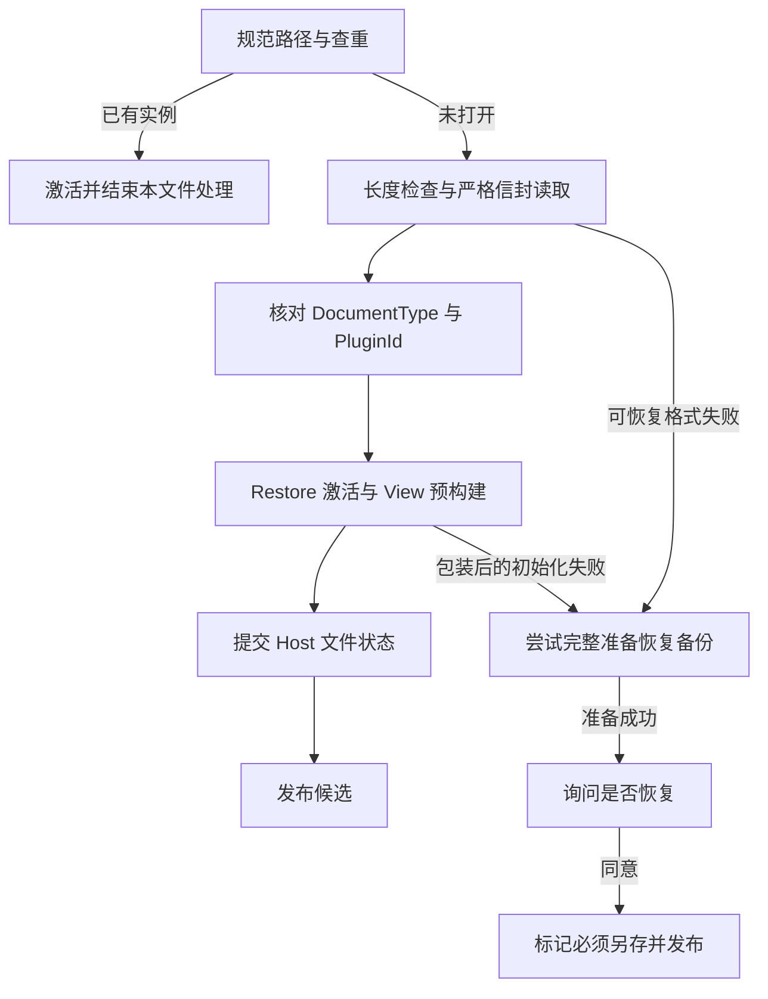

# 文件打开与恢复：候选准备完成后再询问

> 核对日期：2026-09-28。依据：当前实现与文中源码、契约、测试链接。

[上层：文档模块](README.md) · [文档总览](../README.md)

## 打开主路径

OpenAllAsync 在同一个 DocumentOperationGate 中逐个处理文件。先规范化路径，尝试激活已有文档；没有已打开实例才读取。Windows 路径身份按规范绝对路径和大小写不敏感规则比较，显示标题不参与查重。

这是主要分支；不是所有 I/O 错误都会触发恢复提示。具体异常分类由 IsRecoverableOpenFailure 和 IsExpectedPersistenceFailure 区分。

## 严格信封边界

[DocumentEnvelopeSerializer](../../../Host/MyAvaloniaManagement/Business/Documents/DocumentEnvelopeSerializer.cs) 只接受当前 V2 结构，根字段为 schemaVersion、pluginId、documentTypeId、title、savedAtUtc、content；content 包含 schemaVersion 和 payload。它限制字节和深度，拒绝错误字段，不探测历史格式。

Host 检查注册类型可持久化且所有者与信封 PluginId 一致，再给模型 RestoreDocumentActivation。业务内容如何升级由插件处理，Host 不解析 payload 的领域含义。精确格式见[持久化契约](../../reference/document-persistence.md)。

## 恢复为何先初始化再弹窗

[LoadPrimaryOrRecoveryAsync](../../../Host/MyAvaloniaManagement/Business/Documents/DocumentPersistenceCoordinator.cs) 先保留主文件失败，再尝试把备份严格读取、创建模型、初始化并构造 View。只有备份真实可用，才询问用户，避免提供无法兑现的恢复选项。

备份候选始终在 using 内：拒绝、提示异常或发布失败都会回滚。用户拒绝时重新抛出保留的主文件失败。确认后清空当前主文件路径，标记 RequiresSave，登记原件与备份路径，发布恢复页面。

## 恢复副本不能直接覆盖原件

恢复保存必须选择新路径，并拒绝原损坏文件和原恢复备份路径。这样打开损坏文件的尝试不会修改输入，用户还保有排查和手动恢复的材料。成功另存后再清除恢复登记。

批量打开以单个文件为预期失败边界；其中一个失败，后续文件仍可继续。未经分类的程序错误不应一律降级成“文件坏了”。

验证：[DocumentEnvelopeV2Tests](../../../Host/MyAvaloniaManagement.Tests/DocumentEnvelopeV2Tests.cs)、[DocumentPersistenceTests](../../../Host/MyAvaloniaManagement.Tests/DocumentPersistenceTests.cs)。继续：[保存提交](05-save-and-revision.md)。
