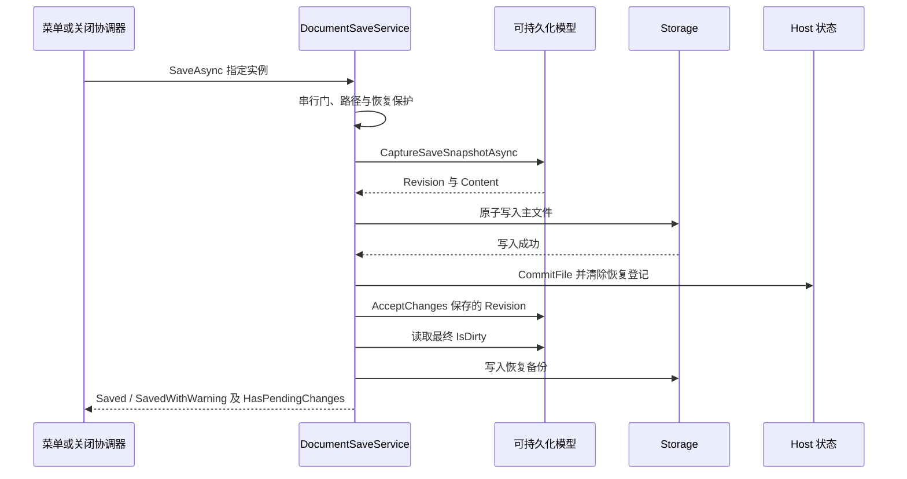

# 保存与修订：主文件提交以后不能倒写结果

> 核对日期：2026-09-28。依据：当前实现与文中源码、契约、测试链接。

[上层：文档模块](README.md) · [文档总览](../README.md)

## 保存的完整时序



## 唯一业务提交点

[SaveCoreAsync](../../../Host/MyAvaloniaManagement/Business/Documents/DocumentSaveService.cs) 先确认模型可持久化、Host 已有规范注册状态，再决定保存路径。新文档和恢复副本需要路径选择；取消返回 Canceled。恢复副本还需通过禁止覆盖原件和备份的检查。

捕获内容、序列化信封和主文件写入属于提交前阶段。它们失败时返回 Failed；关闭令牌导致的协作取消单独映射。文件写入成功之后，内存状态立即跟进：

```csharp
persistenceStates.CommitFile(document, filePath, hostTitle);
recoveryRegistry.Clear(document);
```

随后插件 AcceptChanges 或备份失败，不会把已落盘的事实改回“保存失败”。它们产生 SavedWithWarning，调用者仍可向用户说明后续步骤异常。

## 修订如何保护保存期间的新修改

假设捕获时内容修订为 R1，磁盘写入期间模型修改到 R2。AcceptChanges(R1) 只确认 R1；若插件正确保留 R2 的脏状态，SaveService 返回 HasPendingChanges。普通保存完成，但关闭协调器必须保留页面。

Revision 是插件内存协议，Host 不解释其值，也不把它写进文档信封。它需要与内容快照来自同一个稳定观察区间，不能先读内容、很久后再读修订。

## 结果矩阵

| 条件 | 文件事实 | 返回及关闭影响 |
| --- | --- | --- |
| 用户取消路径选择 | 未写入 | Canceled，保持打开 |
| 捕获、序列化或写入失败 | 未完成主提交 | Failed |
| 主写入成功且后续成功 | 已保存快照 | Saved |
| 确认或备份异常 | 已保存快照 | SavedWithWarning |
| 保存期间出现新修改 | 旧快照已保存 | HasPendingChanges，不能因此关闭 |

即使 AcceptChanges 抛异常，finally 仍刷新修改标记。关闭流程会最终重读脏状态，不因一次保存返回成功就默认所有修改都已处理。

存储细节继续看[原子文件事务](../09-infrastructure/01-storage-and-transactions.md)。验证入口：[DocumentPersistenceTests](../../../Host/MyAvaloniaManagement.Tests/DocumentPersistenceTests.cs)、[DocumentCloseTests](../../../Host/MyAvaloniaManagement.Tests/DocumentCloseTests.cs)。
