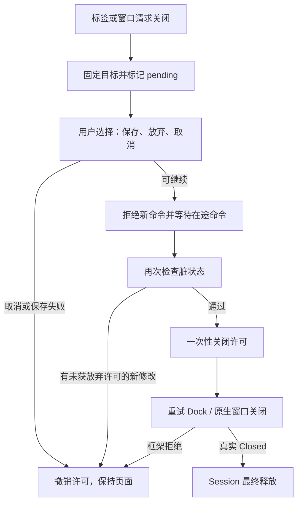

# 关闭与释放：许可、等待、复核和框架重入

> 核对日期：2026-09-28。依据：当前实现与文中源码、契约、测试链接。

[上层：文档模块](README.md) · [文档总览](../README.md)

## 关闭是一个可撤销过程



## 同步回调怎样接异步确认

Dock 的 Closing 回调不能直接等待用户交互。DocumentCloseCoordinator 在需要确认或排空时，先拒绝当前同步关闭，再观察异步准备任务；条件满足后记录一次性许可并重试原关闭操作。重复请求不能启动第二次确认。

范围关闭使用 PrepareRangeCloseAsync 返回 DocumentCloseApproval。它只是撤销许可的租约，不拥有文档资源。窗口在提交完成、否决或范围变化时释放它。

## 最后一次复核保护什么

源码 [VerifyFinalStateAsync](../../../Host/MyAvaloniaManagement/Business/Documents/DocumentCloseCoordinator.cs) 的核心条件：

```csharp
if (!targets.Any(document => persistenceStates.IsDirty(document) && !discarded.Contains(document)))
    return true;
```

discarded 只包含用户确认时明确放弃的脏文档。范围中原本干净的另一页，如果在等待命令结束时变脏，不会自动获得放弃许可。保存后仍有更新修订，也必须保持页面。

## 命令租约与关闭令牌

命令 Lease 先关闭该 Adapter 的新调用入口、请求取消并等待真实 Task 结束，避免释放正在执行命令的模型。它不是立即销毁 Scope。Adapter 的 ClosingToken 属于真正文档寿命，最终资源链才取消并释放。

若 Dock 或原生窗口否决关闭，协调器撤销未消费许可并重开命令入口。单页等待期间变为浮窗最后一页时，可以将精确单页许可接续给整窗流程，但不能扩大目标范围。

## 最终释放链

真实关闭进入 WorkspaceSession.ReleaseDocument，先撤回旧活动 Target 和页面跟踪，再清理关闭状态，交 DockDocumentLifetime 移除缓存并释放 Adapter。Adapter 解绑事件、断开 View，最后释放激活租约及 Scope。即使 View 清理失败，finally 仍尝试关闭业务资源。

源码：[CloseCoordinator](../../../Host/MyAvaloniaManagement/Business/Documents/DocumentCloseCoordinator.cs)、[DockWindowCloseCoordinator](../../../Host/MyAvaloniaManagement/Business/Docking/DockWindowCloseCoordinator.cs)、[ManagedDocumentDockable](../../../Host/MyAvaloniaManagement/Business/Docking/ManagedDocumentDockable.cs)。验证：[DocumentCloseTests](../../../Host/MyAvaloniaManagement.Tests/DocumentCloseTests.cs)、[DockWindowCloseTests](../../../Host/MyAvaloniaManagement.Tests/DockWindowCloseTests.cs)、[DocumentWindowV16UiTests](../../../Host/MyAvaloniaManagement.UiTests/DocumentWindowV16UiTests.cs)。
