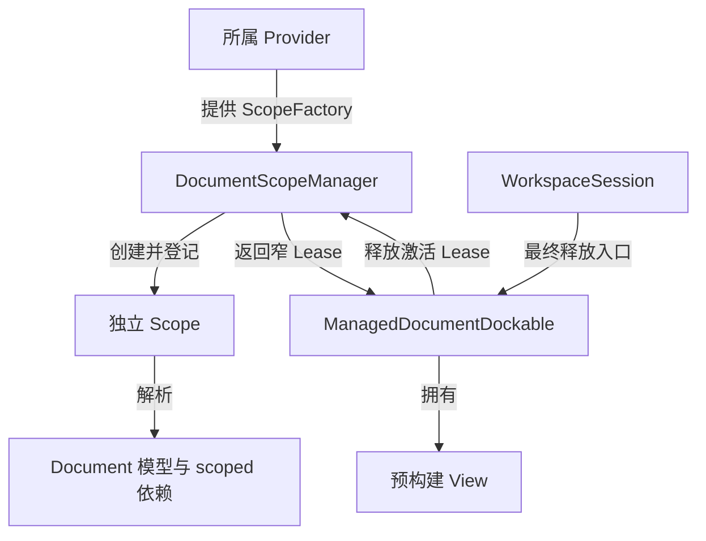

# 文档所有权与并发：一个 Scope 和两个等待边界

> 核对日期：2026-09-28。依据：当前实现与文中源码、契约、测试链接。

[上层：文档模块](README.md) · [文档总览](../README.md)

## 对象由谁释放



ScopeManager 以模型引用为键登记 Scope，避免同名或同类型实例互相覆盖。插件只获得 IDocumentLifetime 的关闭事实，不能取得并主动释放 IServiceScope，也不能主动触发 Host 的 CTS。

## 创建时的局部所有权

[CreateScopedModel](../../../Host/MyAvaloniaManagement/Business/Documents/Ownership/DocumentScopeManager.cs) 先把新 Scope 保存在局部变量。只有模型解析、Lifetime 获取和唯一登记全部成功，才清空局部变量、把释放责任交给管理器。构造失败或重复模型会在 finally 释放局部资源。

Release 先在锁内移除登记，随后在锁外执行用户 Dispose，避免重入和长时间占锁。租约的幂等释放与管理器兜底共同覆盖正常关闭、创建失败和 Runtime 退出。

## 串行门的实际范围

[DocumentOperationGate](../../../Host/MyAvaloniaManagement/Business/Documents/DocumentOperationGate.cs) 共用于新建、打开及保存。它将已经接受但仍排队的请求也计入 _pending：

以下源码片段省略说明性注释，保留执行语句和顺序。

```csharp
await _gate.WaitAsync();
entered = true;
lock (_stateGate)
    if (!_accepting) throw new InvalidOperationException("Host 正在关闭，排队的文档操作已停止。");
return await operation();
```

获得信号量后重查准入，保证关闭前排队、关闭后才轮到的请求不再调用插件。finally 无论成功失败都减计数，排空 Task 才能真实表示所有请求结束。

BeginShutdown 关闭入口但不 Dispose 信号量；运行中的初始化仍有机会返回并由原调用链回滚。默认排空宽限为 5 秒，超时只返回未排空，不表示已强制停止。

## 两个门不能合并理解

DocumentOperationGate 序列化文档用例；WorkbenchDocumentCommandLeaseStore 按具体 Adapter 追踪插件命令。前者可保护功能中心创建，后者保护单页关闭。Runtime 退出需要分别等待。

常见误改包括：在隐藏或浮动时释放 Scope；把尚未发布的候选当作无人拥有；只统计正在执行而遗漏排队请求；将未结束 Task 的取消当成安全释放依据。

验证：[DocumentScopeManagerTests](../../../Host/MyAvaloniaManagement.PluginTests/DocumentScopeManagerTests.cs)、[DocumentOperationShutdownTests](../../../Host/MyAvaloniaManagement.Tests/DocumentOperationShutdownTests.cs)、[DocumentControlRecyclingTests](../../../Host/MyAvaloniaManagement.UiTests/DocumentControlRecyclingTests.cs)。
