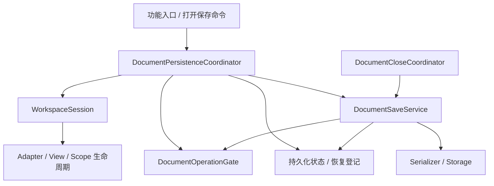

# 文档模块：创建、持久化、关闭和释放

> 核对日期：2026-09-28。依据：当前实现与文中源码、契约、测试链接。

[返回文档总览](../README.md)

## 模块总览

文档模块负责内容操作与关闭决策。Session 拥有发布及释放；SaveService 拥有保存提交；模型拥有内容语义。Document 不是“一个文件路径加一个控件”。

## 逐层阅读

1. [概念](01-concepts.md)：激活、修订、脏状态、路径和恢复。
2. [内部结构](02-internal-structure.md)：协作者与各自状态。
3. [创建和激活](03-create-and-activate.md)：初始化成功后再发布。
4. [打开和恢复](04-open-and-restore.md)：严格读取、查重和恢复候选。
5. [保存与修订](05-save-and-revision.md)：文件提交和内容确认。
6. [关闭与释放](06-close-and-release.md)：异步确认、命令排空和最终检查。
7. [所有权与并发](07-ownership-and-concurrency.md)：Scope、门控与失败清理。
8. [源码与测试导读](08-code-and-tests.md)：按问题定位方法和验证。

文件格式以[持久化契约](../../reference/document-persistence.md)为准。这里着重解释格式被谁使用、什么时机更新状态。
