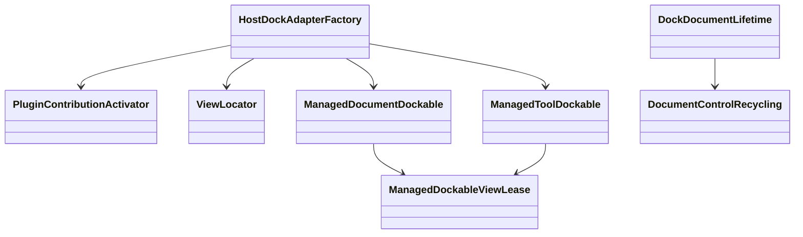

# Adapter 与 View：普通模型如何进入 Dock

> 核对日期：2026-09-28。依据：当前实现与文中源码、契约、测试链接。

[上层：Dock 与布局](README.md) · [文档总览](../README.md)

## 精确适配链

插件实现普通模型和 View；Host internal Adapter 才承接 Dock Document/Tool。这样 Dock 的继承约束、回调与生命周期不会成为每个插件的业务基类。

## ViewLocator 不按名字猜测

[ViewLocator](../../../Host/MyAvaloniaManagement/ViewLocator.cs) 从当前 Runtime 的显式精确映射取得 View 工厂。它不扫描 AppDomain，不以 ViewModel 后缀推算 View 类型。Prepare 在发布前构造 View 并绑定模型，后续 Dock 渲染得到同一实例。

预构建让失败仍处在可回滚阶段。View 构造失败时 Document Scope 释放；Tool 只释放已取得的 View，singleton 模型继续属于 Provider。

## 控件唯一性和跨窗口

[DocumentControlRecycling](../../../Host/MyAvaloniaManagement/Business/Docking/DocumentControlRecycling.cs) 是当前 Host 容器唯一实例，由 App 资源、Dock 样式和关闭链共用。它维护正文控件的回收与已知父级解除，不能把同一 Control 同时挂到两个父级，也不能因重建模板而创建第二个正文。

把 Document 移到浮窗时保留模型、Scope 和 View，变化的是控件的挂接位置。Host 的 Avalonia 跨窗布局补丁处理旧根残留布局任务；控件缓存本身不负责修复框架调度队列。

## Dispose 的嵌套 finally

[ManagedDocumentDockable.Dispose](../../../Host/MyAvaloniaManagement/Business/Docking/ManagedDocumentDockable.cs) 幂等设置 disposed，解除模型事件，释放 View，最后释放激活 Lease。即使自定义事件退订或 View 清理抛异常，底层 Scope 释放仍被 finally 覆盖。

[DockDocumentLifetime.Release](../../../Host/MyAvaloniaManagement/Business/Docking/DockDocumentLifetime.cs) 先移除回收缓存，再在 finally 调用 Adapter.Dispose。关闭链使用注入实例，不读取 Application.Current 的全局资源猜所有者。

验证：[HostDockAdapterTests](../../../Host/MyAvaloniaManagement.Tests/HostDockAdapterTests.cs)、[DocumentControlRecyclingTests](../../../Host/MyAvaloniaManagement.UiTests/DocumentControlRecyclingTests.cs)、[DockCrossWindowLayoutUiTests](../../../Host/MyAvaloniaManagement.UiTests/DockCrossWindowLayoutUiTests.cs)。补丁边界见[支撑能力](../09-infrastructure/03-compatibility-and-patches.md)。
