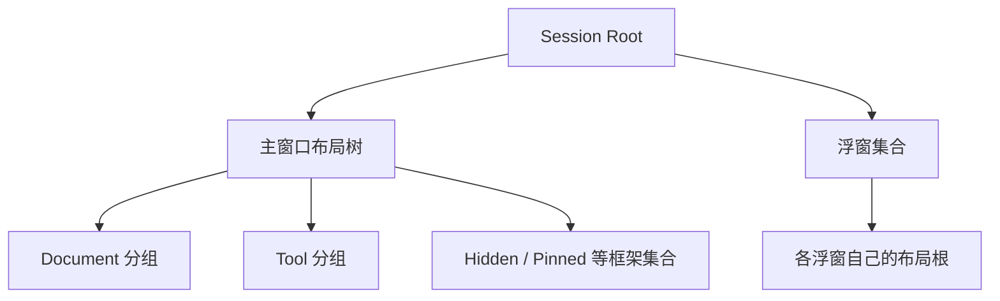

# 布局树与窗口：稳定骨架、浮动内容与位置

> 核对日期：2026-09-28。依据：当前实现与文中源码、契约、测试链接。

[上层：Dock 与布局](README.md) · [文档总览](../README.md)

## 树的职责

DockWorkspaceBuilder 建立主窗口四向工作区和文档区；DockTreeNavigator 集中遍历主树、浮窗、隐藏及自动隐藏项。业务代码不应在多个 ViewModel 中复制不同版本的遍历。

这是一张结构示意图，不表示所有集合都由同一个节点直接存储。准确 Owner 与框架集合以 Navigator 和 Dock 类型为准。尤其要区分“只遍历主树”和“包含 Windows 的完整工作区”。

## Factory 与 Session 的双向接缝

[HostDockFactory](../../../Host/MyAvaloniaManagement/Business/Docking/HostDockFactory.cs) 是 Dock Factory 的适配者，按框架顺序执行 override，然后把真实变化交给一次性绑定的 IWorkspaceDockCallbacks。Session 拥有业务集合，Factory 不再维护另一份文档索引。

Closing 要先通过 Host 的关闭确认；Closed 使用 finally 保证 Session 最终收尾。普通 Docked 回调更新业务状态，SplitToDock 的完成回调则提供原目标、新插入结构和分割操作，供局部策略处理。

## 工具全宽与普通分割

ToolDockCoordinator 针对明确的主窗口稳定目标调整工具方向和区域填充。工具内部的局部分割、浮窗分割继续遵守框架结果。若把所有 Docked 都解释成主区重排，会破坏局部分组。

固定工作区骨架与可浮动内容也不同。Document 和 Tool 可以浮动；主窗口稳定结构不应被当作普通内容拖离。

## 窗口上下文

[WorkbenchWindowContext](../../../Host/MyAvaloniaManagement/Business/Presentation/WorkbenchWindowContext.cs) 登记工作台窗口并提供来源窗口事实；WindowPlacementTracker 记录正常尺寸，最大化不覆盖正常窗口 bounds。

[DockScreenPlacement](../../../Host/MyAvaloniaManagement/Business/Layout/DockScreenPlacement.cs) 处理屏幕匹配和位置校正。持久化 X/Y 使用屏幕像素，宽高使用 Avalonia 逻辑尺寸；缩放是恢复提示，不能直接把所有坐标当成同一单位。

窗口是呈现宿主，Document Scope 仍归 Session/ScopeManager。关闭浮窗需走[范围关闭](../04-documents/06-close-and-release.md)，不能在 Window.Closed 任意 Dispose 当前 DataContext。

验证：[DockFourWayLayoutTests](../../../Host/MyAvaloniaManagement.PluginTests/DockFourWayLayoutTests.cs)、[DockToolSplitUiTests](../../../Host/MyAvaloniaManagement.UiTests/DockToolSplitUiTests.cs)、[DockScreenPlacementTests](../../../Host/MyAvaloniaManagement.Tests/DockScreenPlacementTests.cs)。
