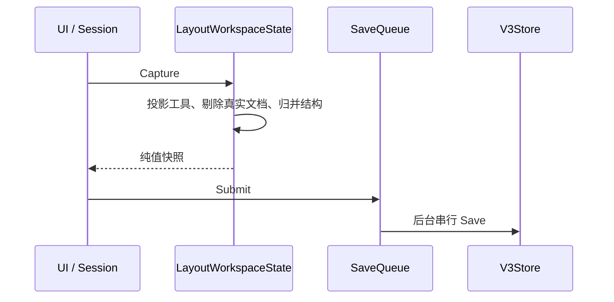

# 布局快照与恢复：纯数据描述空间，实例继续复用

> 核对日期：2026-09-28。依据：当前实现与文中源码、契约、测试链接。

[上层：Dock 与布局](README.md) · [文档总览](../README.md)

## V3 快照保存什么

| 记录 | 内容 |
| --- | --- |
| DockLayoutSnapshotV3 | schema、主窗口、工具浮窗、工具表 |
| DockLayoutWindow | 稳定窗口身份、正常位置与根节点 |
| DockLayoutNode | split、tools 或 documents 占位 |
| DockLayoutTool | 显隐状态和备用回停位置 |
| DockWindowBounds | 位置、尺寸、最大化与屏幕提示 |

documents 只是在主窗中的唯一占位，不保存真实 Document ID、打开文件列表或业务内容。当前源码只恢复 Layout V3；历史 V1/V2 不进行运行期迁移。

## 从 UI 树到纯值



捕获结束后后台代码不再接触 Control 或 Dock 树。不可用插件工具可以保留纯记录，以便以后重新可用时恢复；它们不需要在当前进程创建模型。

## 存储防线

[DockLayoutV3Json](../../../Host/MyAvaloniaManagement/Business/Layout/DockLayoutV3Json.cs) 和 [Validator](../../../Host/MyAvaloniaManagement/Business/Layout/DockLayoutSnapshotV3.cs) 检查字段、节点种类、比例、唯一性、深度及资源上限。结构合法和当前工具可用是两次不同判断。

[DockLayoutV3Store](../../../Host/MyAvaloniaManagement/Business/Layout/DockLayoutV3Store.cs) 拥有数据根写锁、只读保护、坏文件保留、备份及原子提交。主文件、备份与默认回退是当前恢复路径；无法取得写入能力时不伪装保存成功。

## Apply 的转移与回滚

[DockLayoutWorkspaceState.Apply](../../../Host/MyAvaloniaManagement/Business/Layout/DockLayoutWorkspaceState.Restore.cs) 先验证快照，记录 TransferCheckpoint，建立候选容器，再转移已有 Document/Tool。它保存活动文档，重新挂接并恢复窗口位置；业务模型、Scope 和 View 都继续使用原实例。

```csharp
catch
{
    checkpoint.Restore(session);
    Remembered = rememberedBefore;
    throw;
}
```

这个源码片段说明恢复失败必须回到原集合和窗口关系，而不是重新创建业务对象来掩盖问题。文档浮窗不会从磁盘快照自动复活；当前运行的文档在布局重建时复用并进入文档区。

验证：[DockLayoutV3Tests](../../../Host/MyAvaloniaManagement.Tests/DockLayoutV3Tests.cs)、[DockLayoutV3StoreTests](../../../Host/MyAvaloniaManagement.Tests/DockLayoutV3StoreTests.cs)、[DockLayoutAvailabilityTests](../../../Host/MyAvaloniaManagement.PluginTests/DockLayoutAvailabilityTests.cs)、[DockLayoutV3UiTests](../../../Host/MyAvaloniaManagement.UiTests/DockLayoutV3UiTests.cs)。详细约束见[格式契约](../../reference/dock-layout-snapshot-v3.md)。
