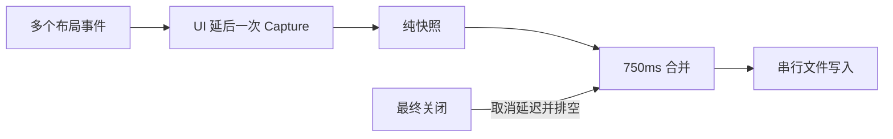

# 布局保存与关闭：捕获时机和最终冻结

> 核对日期：2026-09-28。依据：当前实现与文中源码、契约、测试链接。

[上层：Dock 与布局](README.md) · [文档总览](../README.md)

## 为什么需要两次延后

一次 Dock 操作可能连续修改 Owner、集合、比例和活动项。中途捕获会读到半完成的树。DockLayoutLifecycle 先把变化合并到 UI Dispatcher 的后续回合，再捕获纯快照；SaveQueue 再以静默期合并频繁快照，后台串行写入。

## 三个对象的状态

Lifecycle 拥有 ready、frozen、posted、disposed 和订阅；Queue 拥有最新快照、提交修订、延迟与单写入器；Store 拥有文件和锁。不得让保存队列反过来查询当前 UI，也不得让 Store 负责页面显隐。

[SaveQueue](../../../Host/MyAvaloniaManagement/Business/Layout/DockLayoutSaveQueue.cs) 的修订仅用于文件写入顺序，与 Document 内容 Revision 无关。Flush 取消等待延迟，不取消正在执行的原子事务；旧写入结束之后才允许新修订提交。

## 最终关闭的顺序

[FreezeAndFlushAsync](../../../Host/MyAvaloniaManagement/Business/Layout/DockLayoutLifecycle.cs) 先捕获当前完整布局，再冻结后续变化并排空队列。最终快照必须早于浮窗拆除，否则正常关窗产生的清理事件会覆盖用户布局。

队列不捕获 UI 上下文，所以当前实现允许最终原生关闭同步等待文件排空；日常自动保存仍走后台。若退出取消，Resume 恢复捕获。不要把同步排空随意扩散到需要 UI continuation 的其他任务。

## 浮窗关闭与 Tool 最后一项

HostFloatingWindow 与 HostDockFactory 处理最后一个 Tool 的重复按钮命令和原生关闭顺序。在可取消的 Closing 阶段完成能力与事件检查，短期许可只服务框架后续清理。原生否决后不能先隐藏 Tool，再宣称窗口仍保持原状。

Document 浮窗使用固定范围的文档关闭许可。两类关闭均不由保存队列决定，队列只证明文件写入结束。

源码：[Lifecycle](../../../Host/MyAvaloniaManagement/Business/Layout/DockLayoutLifecycle.cs)、[HostFloatingWindow](../../../Host/MyAvaloniaManagement/Views/HostFloatingWindow.cs)、[DockWindowCloseCoordinator](../../../Host/MyAvaloniaManagement/Business/Docking/DockWindowCloseCoordinator.cs)。验证：[DockLayoutSaveQueueTests](../../../Host/MyAvaloniaManagement.Tests/DockLayoutSaveQueueTests.cs)、[DockToolWindowCloseUiTests](../../../Host/MyAvaloniaManagement.UiTests/DockToolWindowCloseUiTests.cs)、[DocumentWindowV16UiTests](../../../Host/MyAvaloniaManagement.UiTests/DocumentWindowV16UiTests.cs)。
