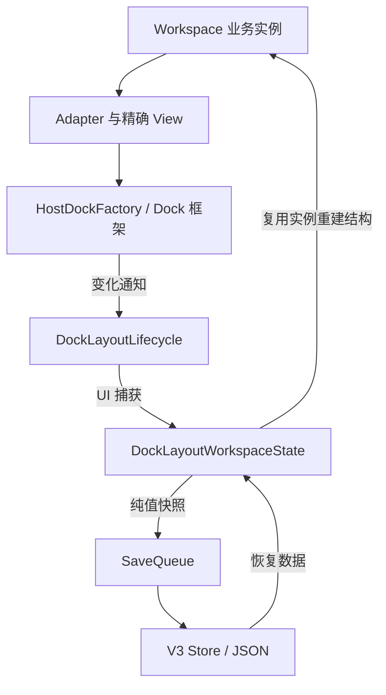

# Dock 与布局：框架适配、空间结构与持久化

> 核对日期：2026-09-28。依据：当前实现与文中源码、契约、测试链接。

[返回文档总览](../README.md)

## 三层结构

业务实例、当前 Dock 树和磁盘快照是不同对象。拖动页面改变呈现归属；布局恢复应复用已有模型；持久化快照只描述可恢复的工具布局和文档占位。

## 阅读顺序

1. [Adapter 与 View](01-adapters-and-views.md)：模型如何进入 Dock，控件如何保持唯一。
2. [布局树与窗口](02-tree-windows-and-placement.md)：稳定骨架、浮窗、分割和屏幕坐标。
3. [快照、存储与恢复](03-snapshot-store-and-restore.md)：V3 结构与转移回滚。
4. [保存调度与关闭](04-save-queue-and-close.md)：UI 捕获、后台串行提交及退出冻结。

格式以[Layout V3 契约](../../reference/dock-layout-snapshot-v3.md)为准。文档内容保存单独见[Document 模块](../04-documents/README.md)。
