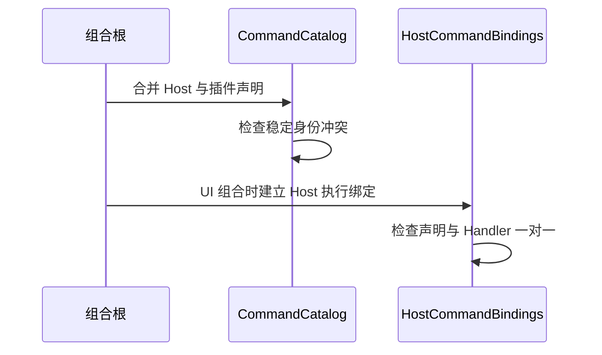

# 命令声明与绑定：目录不持有业务执行对象

> 核对日期：2026-09-28。依据：当前实现与文中源码、契约、测试链接。

[上层：工作台命令](README.md) · [文档总览](../README.md)

## 两次独立校验

WorkbenchCommandCatalog 保存不可变命令事实，不按生命周期过滤，不持有 Provider、Document 模型或 Avalonia ICommand。这样读取目录不需要创建 Workspace 或解析 UI Handler。

HostWorkbenchCommandBindings 在 UI 组合边界建立内建命令到执行对象的映射，检查缺失、重复或多余身份。目录知道“有哪些命令”，Bindings 知道“Host 内建命令由谁执行”。

## 插件命令和 Host 命令

Host 命令通过已绑定 Handler 进入现有用例，如打开、保存、帮助或重启。插件 Document 命令由当前页面模型实现的 Target 承接，不能从插件根容器随意解析一个同类型新模型执行。

状态查询捕获 Route 时保存原 Handler 或当前页面 Target，执行器共用这次路由。若状态与执行分别按 ID 写两套 switch，会出现声明、可用性和实际执行逐渐不一致的问题。

## 声明与展示许可

命令声明、菜单 Placement 和快捷键 Placement 各自表达不同事实。纯快捷键命令不必自动公开到命令面板；普通可发现 Command 使用菜单声明作为发现许可。Host 保留快捷键与冲突治理在展示投影中处理，不通过修改原目录抹掉插件声明。

## 代码阅读

[HostWorkbenchCommandCatalog](../../../Host/MyAvaloniaManagement/Business/Commands/Catalog/HostWorkbenchCommandCatalog.cs) → [WorkbenchCommandCatalog](../../../Host/MyAvaloniaManagement/Business/Commands/Catalog/WorkbenchCommandCatalog.cs) → [HostWorkbenchCommandBindings](../../../Host/MyAvaloniaManagement/Business/Commands/Execution/HostWorkbenchCommandBindings.cs)。SDK 的声明类型见 [WorkbenchCommandContracts](../../../Host/MyAvaloniaManagement.PluginSdk/WorkbenchCommandContracts.cs)。

验证：[WorkbenchCommandRegistrationTests](../../../Host/MyAvaloniaManagement.Tests/WorkbenchCommandRegistrationTests.cs)、[WorkbenchCommandCatalogExecutorTests](../../../Host/MyAvaloniaManagement.Tests/WorkbenchCommandCatalogExecutorTests.cs)、[WorkbenchCommandHostHandlerTests](../../../Host/MyAvaloniaManagement.Tests/WorkbenchCommandHostHandlerTests.cs)。下一层：[目标捕获](02-context-and-execution.md)。
