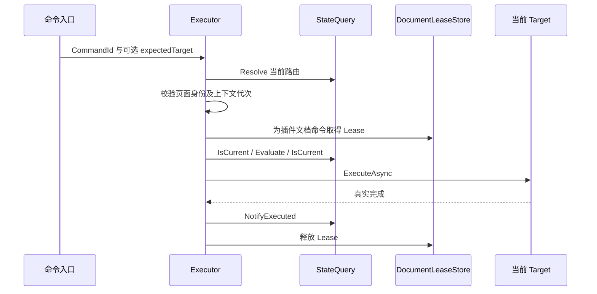

# 上下文与执行：防止命令落到另一张页面

> 核对日期：2026-09-28。依据：当前实现与文中源码、契约、测试链接。

[上层：工作台命令](README.md) · [文档总览](../README.md)

## 展示快照与内部捕获

WorkbenchContextSnapshot 只包含活动类型、owner、能力和上下文代次等纯值。内部 Capture 额外携带实际 Adapter、SDK Target 和 ClosingToken，供短期路由使用。纯快照不保存模型、Control、Scope 或任意对象字典。



## 重查为什么有多次

[Executor.ExecuteAsync](../../../Host/MyAvaloniaManagement/Business/Commands/Execution/WorkbenchCommandExecutor.cs) 先解析目录和目标，再取得关闭租约。取得租约期间或 CanExecute 回调期间，活动实例、owner 或上下文代次可能变化，所以执行前再次确认路由仍有效。

```csharp
if (expectedTarget is not null && !expectedTarget.Matches(route.Capture))
{
    return WorkbenchCommandExecutionResult.FromStatus(WorkbenchCommandExecutionStatus.TargetUnavailable);
}
```

这是当前源码片段。命令面板明确展示过目标时传 expectedTarget，旧提交失效就拒绝；菜单和快捷键传 null，使用原有“当前目标”语义。预期目标随调用传递，不存入可复用的共享命令对象。

## 状态枚举表达什么

CommandNotFound 表示目录不存在；OwnerUnavailable 表示插件当前不可用；TargetUnavailable 表示目标缺失或身份不匹配；Disabled 表示 CanExecute 不允许或判断异常；Enabled 表示当前观察可执行。Enabled 不是一张永久执行凭证。

StateQuery 只订阅当前 Target 的状态事件。切换时先使旧代次失效，再退订/订阅；后台事件要同时核对 sender、owner、类型和命令身份，避免迟到通知污染新页面。

## 取消和异常

插件命令链接调用者取消、文档命令关闭租约、Adapter ClosingToken 和 Host 退出取消。执行器等待实际 Task，插件异常转换为受控结果和稳定诊断，不把异常正文送到 UI。NotifyExecuted 在 Lease 释放前进行，避免关闭 continuation 先销毁 Target 后刷新状态。

源码：[ContextStore](../../../Host/MyAvaloniaManagement/Business/Commands/Context/WorkbenchContextStore.cs)、[StateQuery](../../../Host/MyAvaloniaManagement/Business/Commands/State/WorkbenchCommandStateQuery.cs)、[TargetExpectation](../../../Host/MyAvaloniaManagement/Business/Commands/Context/WorkbenchCommandTargetExpectation.cs)。验证：[WorkbenchCommandContextStateTests](../../../Host/MyAvaloniaManagement.Tests/WorkbenchCommandContextStateTests.cs)、[WorkbenchCommandDocumentTargetTests](../../../Host/MyAvaloniaManagement.Tests/WorkbenchCommandDocumentTargetTests.cs)、[CommandPaletteV18TargetTests](../../../Host/MyAvaloniaManagement.Tests/CommandPaletteV18TargetTests.cs)。
