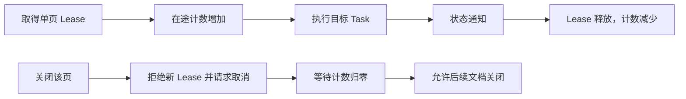

# 命令租约与退出：执行完毕才能释放页面

> 核对日期：2026-09-28。依据：当前实现与文中源码、契约、测试链接。

[上层：工作台命令](README.md) · [文档总览](../README.md)

## 两个范围

| 范围 | 所有者 | 等待目的 |
| --- | --- | --- |
| 单个 Document | WorkbenchDocumentCommandLeaseStore | 标签或浮窗关闭前等待当前模型上的命令 |
| 整个 Runtime | WorkbenchCommandExecutor / ShutdownGate | Provider 释放前等待全部命令 |

## Lease 不是文档所有权

Lease 记录一次命令还在使用某个 Adapter。它不持有最终释放权，不调用 Scope.Dispose。文档关闭协调器获得排空证明后，再通过 Dock 与 Session 的现有流程释放。

[WorkbenchDocumentCommandLeaseStore](../../../Host/MyAvaloniaManagement/Business/Commands/Execution/WorkbenchDocumentCommandLeaseStore.cs) 按 Adapter 引用计数。关闭取消或框架拒绝时 Reopen 恢复入口，不能把“关闭中”永久留在未关闭页面上。单页等待不设置强制释放超时。

## Runtime 退出

Executor.BeginShutdown 幂等关闭入口并传播退出取消，WaitForDrainAsync 等待真实在途计数归零。全局门控使用关闭宽限；超时返回不安全结论，由 Runtime 保留对象图。它不能通过提前 EndInvocation 让运行中的 Handler 从统计中消失。

finally 必须覆盖返回拒绝、CanExecute 失败、执行异常以及取消；漏掉任意分支会造成永久无法排空。相反，过早释放 Lease 可能让关闭路径先销毁 Target。

## 验证边界

从 [Executor](../../../Host/MyAvaloniaManagement/Business/Commands/Execution/WorkbenchCommandExecutor.cs) 的 TryBeginInvocation / EndInvocation 看全局计数，再看单页 Store 的 TryAcquire / BeginClose / Reopen，最后回到 [DocumentCloseCoordinator](../../../Host/MyAvaloniaManagement/Business/Documents/DocumentCloseCoordinator.cs)。

测试：[WorkbenchCommandShutdownGateTests](../../../Host/MyAvaloniaManagement.Tests/WorkbenchCommandShutdownGateTests.cs)、[WorkbenchCommandDocumentTargetTests](../../../Host/MyAvaloniaManagement.Tests/WorkbenchCommandDocumentTargetTests.cs)、[DocumentCloseTests](../../../Host/MyAvaloniaManagement.Tests/DocumentCloseTests.cs)。文档操作门的独立责任见[文档并发](../04-documents/07-ownership-and-concurrency.md)。
