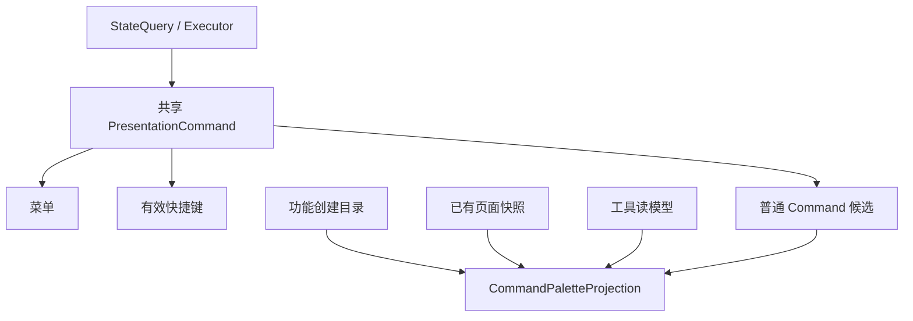

# 命令呈现：菜单、快捷键和四类搜索结果

> 核对日期：2026-09-28。依据：当前实现与文中源码、契约、测试链接。

[上层：工作台命令](README.md) · [文档总览](../README.md)

## 一套执行语义，多种入口

同一个保存命令可以同时出现在菜单和快捷键中，复用 PresentationCommand。它的 CanExecute 读实时 StateQuery，执行仍进入 Executor。UI 不保存另一份可执行状态真相。

## Palette 的四类身份

功能候选执行创建；页面候选激活既有 PageId；工具候选打开或定位工具；普通命令候选执行 CommandId。它们使用强类型身份区分，不依靠若干可空字段猜操作。

WorkbenchCommandPaletteProjection 汇合候选并应用发现许可、筛选和排序。WorkbenchPalettePresentation 保存纯值行数据与分组规则。CommandPaletteView 管查询、选择、滚动、预编辑输入和忙碌错误，不读取插件 Provider 或 Scope。

## 执行和焦点

[WorkspacePaletteActions](../../../Host/MyAvaloniaManagement/Business/Presentation/Commands/WorkspacePaletteActions.cs) 把前三类适配到已有创建、激活及工具用例，并重新校验身份、可用性和关闭状态。页面失效不能换成同名页面。

功能初始化成功后才关闭遮罩；失败保留查询和身份。普通 Command 先关闭遮罩再执行。异步焦点交还还要检查窗口活动代次、面板会话和结果页面，不能让迟到 continuation 抢走新窗口焦点。

## 通知合并

[UiRefreshScheduler](../../../Host/MyAvaloniaManagement/Business/Presentation/Commands/UiRefreshScheduler.cs) 只管理刷新时机及 pending/disposed。菜单、快捷键和命令在 UI 线程可立即刷新，Palette 排队刷新。各消费者保留自己的订阅和异常政策，调度器不判断业务状态。

命令面板会话暂停其他生成 KeyBinding，关闭后恢复；Ctrl+Shift+P 保持 Host 保留入口。窗口释放需成对退订，不能靠 GC 解决订阅持有。

源码：[CommandPresentation](../../../Host/MyAvaloniaManagement/Business/Presentation/Commands/WorkbenchCommandPresentation.cs)、[PaletteProjection](../../../Host/MyAvaloniaManagement/Business/Presentation/Commands/WorkbenchCommandPaletteProjection.cs)、[CommandPaletteView](../../../Host/MyAvaloniaManagement/Views/CommandPaletteView.axaml.cs)。验证：[WorkbenchCommandPresentationTests](../../../Host/MyAvaloniaManagement.Tests/WorkbenchCommandPresentationTests.cs)、[CommandPaletteV18UiTests](../../../Host/MyAvaloniaManagement.UiTests/CommandPaletteV18UiTests.cs)、[UiRefreshSchedulerTests](../../../Host/MyAvaloniaManagement.UiTests/UiRefreshSchedulerTests.cs)。
