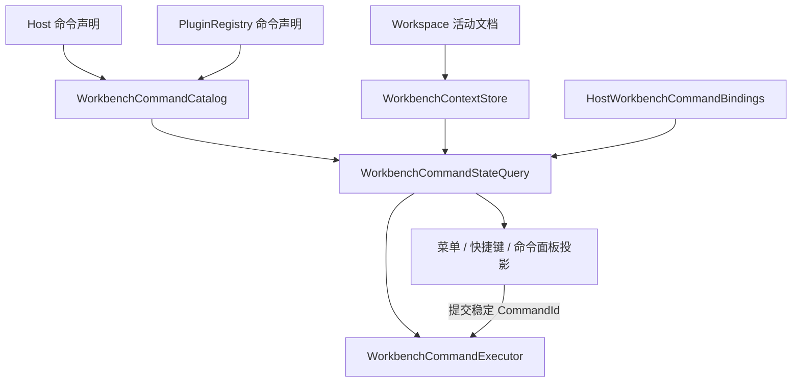

# 工作台命令：声明、当前目标、执行和界面投影

> 核对日期：2026-09-28。依据：当前实现与文中源码、契约、测试链接。

[返回文档总览](../README.md)

## 模块总图

命令是用户操作身份。目录保存声明，Context 保存当前目标事实，StateQuery 判断可用性，Executor 执行。菜单按钮的 Enabled 只是一时展示，执行器必须再次检查。

## 阅读顺序

1. [声明与目录](01-catalog-and-bindings.md)。
2. [上下文与执行](02-context-and-execution.md)。
3. [单文档租约和退出](03-leases-and-shutdown.md)。
4. [菜单、快捷键与 Palette](04-presentation-and-palette.md)。

用户契约以[Workbench Command](../../reference/workbench-commands.md)为准。跨插件 JSON 调用使用另一套[Workflow Action](../07-workflow-actions/README.md)机制。
