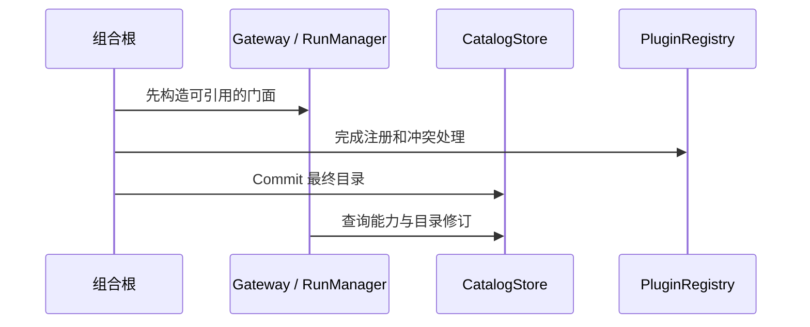

# Workflow 目录与契约：调用者身份和固定目录修订

> 核对日期：2026-09-28。依据：当前实现与文中源码、契约、测试链接。

[上层：Workflow Action](README.md) · [文档总览](../README.md)

## 三种身份

ActionId 标识能力，OwnerId 标识提供能力的插件，CallerId 标识请求能力的插件。InvocationId 标识一次实际调用。CallerId 由 Host 注入 Gateway 时绑定，消费者不能在每次请求参数中自报另一个插件身份。

## 为什么需要可单次提交的 Store

Host Provider 先建立，插件 Registry 后完成。插件 Consumer 的依赖可能提前引用 Gateway，因此 CatalogStore 先存在，但必须等待注册冲突处理完成后一次性 Commit。提交前不能创建可执行 Run；提交后目录只读，没有追加、删除或刷新接口。

[WorkflowActionCatalogStore](../../../Host/MyAvaloniaManagement/Business/WorkflowActions/WorkflowActionCatalogStore.cs) 保存声明和可用性查询，按调用者过滤自己的 Action。隐藏不构成唯一防线，执行入口仍再次检查自调用。

## JSON 契约的边界

Descriptor 声明输入输出 Schema、确认策略、风险及敏感字段指针等。SchemaValidator 检查结构和预算；Host 不理解具体业务 DTO。传入与返回 JsonElement 会克隆，避免源 JsonDocument 释放后借用失效。

Workflow SDK 的目录修订用于描述契约集合。Run 捕获该修订，执行时再次比对，避免使用与已建立 Run 不一致的声明。当前目录本身单次提交，该机制明确了 Run 与契约的绑定。

## 读代码时关注

先读基础 SDK 的 [WorkflowActionContracts](../../../Host/MyAvaloniaManagement.PluginSdk/WorkflowActionContracts.cs)，再读 CatalogStore，最后读 [SchemaValidator](../../../Host/MyAvaloniaManagement/Business/WorkflowActions/WorkflowActionSchemaValidator.cs)。资源数值和 Schema 支持子集以[现行契约](../../reference/workflow-actions.md)为准，不按通用 JSON Schema 库的全部能力推断。

验证：[WorkflowActionKernelTests](../../../Host/MyAvaloniaManagement.Tests/WorkflowActionKernelTests.cs)、[WorkflowActionG1IntegrationTests](../../../Host/MyAvaloniaManagement.PluginTests/WorkflowActionG1IntegrationTests.cs)。下一篇：[一次调用](02-invocation-and-authorization.md)。
