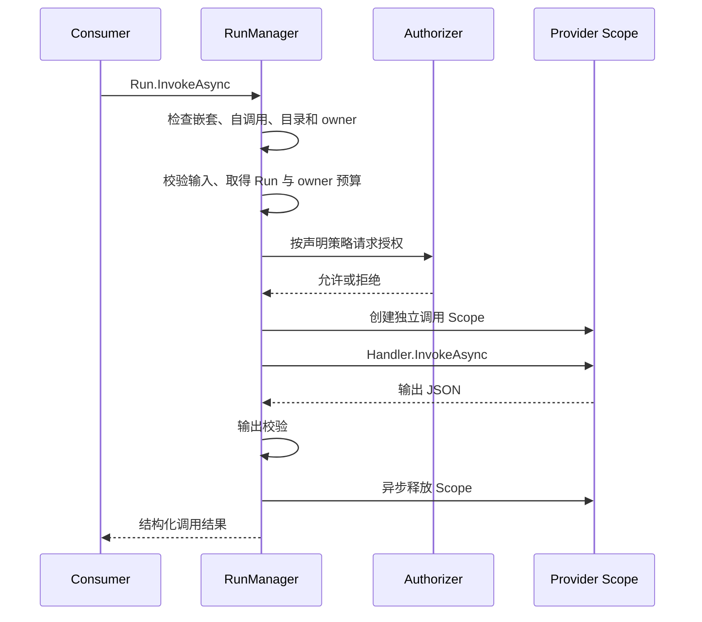

# Workflow 调用：先治理，后进入 Provider Scope

> 核对日期：2026-09-28。依据：当前实现与文中源码、契约、测试链接。

[上层：Workflow Action](README.md) · [文档总览](../README.md)

## 调用顺序



## 先拒绝，再消耗资源

[RunManager.InvokeAsync](../../../Host/MyAvaloniaManagement/Business/WorkflowActions/WorkflowActionRuntime.cs) 首先检查 Handler 内嵌套和自调用。自调用拒绝发生在 Host 活跃计数与并发预算之前，因此手工构造被目录隐藏的 ActionId 也不会触发授权或 Provider Scope。

通过全局准入后再检查 owner 可用性、输入 Schema、Run 并发及 owner 并发。预算在 finally 对称归还，不能在授权拒绝或异常时泄漏名额。

## 授权属于调用治理

Never、EveryInvocation 等策略由声明决定。一次 Run 内可复用的确认按目录修订、ActionId 和规范化输入摘要形成键，输入变更不能意外沿用旧确认。授权器使用敏感指针生成受控参数摘要。

授权 UI 或回调异常按拒绝处理，不能默认授权。这里描述的是应用自身 Workflow 机制，与编写文档时的工具授权无关。

## Scope 代码片段

```csharp
await using var scope = _scopeFactory.CreateWorkflowActionScope(
    registration.OwnerId, registration.HandlerType);
using var invocationGuard = WorkflowActionInvocationGuard.Enter();
```

这段当前源码位于 InvokeHandlerAsync。Scope 从提供者私有容器创建，Handler 在其中解析；它不是 Consumer 的 Document Scope，也不跨调用复用。Guard 使用异步调用链状态禁止 Handler 再进入 Workflow。

Handler 接收克隆参数、InvocationId、CallerId 和进度端口，返回后还要验证输出和预算。输出不合法意味着失败，不因为 Handler 返回正常就跳过边界检查。

验证：[WorkflowActionKernelTests](../../../Host/MyAvaloniaManagement.Tests/WorkflowActionKernelTests.cs)、[WorkflowActionG1IntegrationTests](../../../Host/MyAvaloniaManagement.PluginTests/WorkflowActionG1IntegrationTests.cs)。Scope 创建实现在 [PluginProviderOwner.CreateWorkflowActionScope](../../../Host/MyAvaloniaManagement/Business/Plugins/Registration/PluginProviderOwner.cs)。
