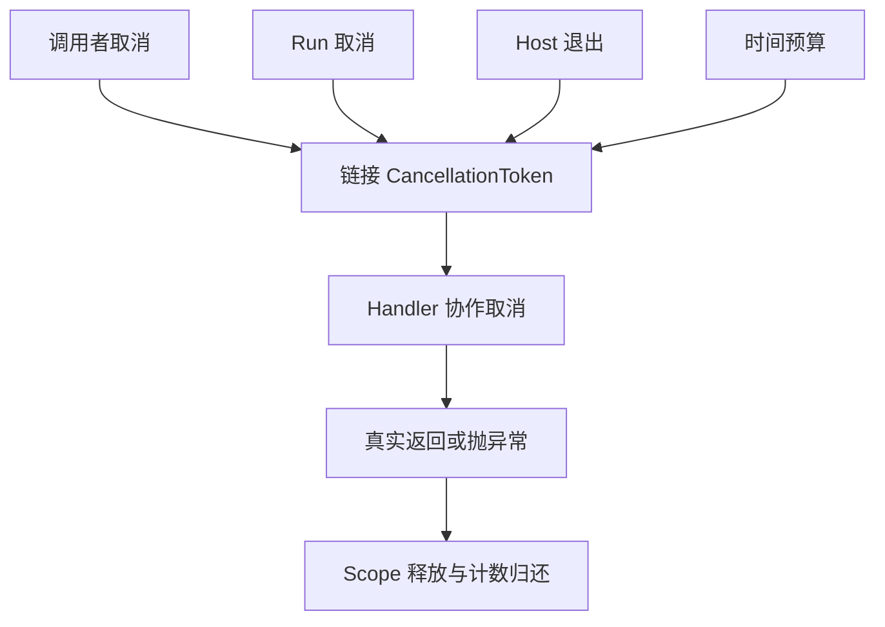

# Workflow 预算与退出：超时不会强杀插件

> 核对日期：2026-09-28。依据：当前实现与文中源码、契约、测试链接。

[上层：Workflow Action](README.md) · [文档总览](../README.md)

## 不同预算的含义

| 预算 | 防止的问题 |
| --- | --- |
| 输入输出大小、Schema 深度与集合限制 | 无界数据进入 Host |
| 每 Run 并发 | 单次消费者运行占满能力 |
| 每 owner 并发 | 多个 Run 一起压垮同一提供者 |
| 执行时间 | 长时间调用的协作取消 |
| 进度最小间隔 | 高频进度通知压垮 UI |
| Host 退出宽限 | 判定是否可以安全释放 Provider |

默认每 Run 与每 owner 并发均为 4，普通时间预算 5 分钟，LongRunning 为 6 小时，退出宽限 10 秒，进度最小间隔 100 毫秒。这些值集中在 [WorkflowActionExecutionLimits](../../../Host/MyAvaloniaManagement/Business/WorkflowActions/WorkflowActionRuntime.cs)，可在测试注入；修改时同步核对[契约](../../reference/workflow-actions.md)。

## 取消的实际执行

InvokeHandlerAsync 使用链接令牌，但仍 await Handler 的真实任务。插件忽略取消时，调用不会通过“超时结果”提前释放 Scope。只有能够证明 Handler 已退出，才有安全释放条件。

超时与调用者/Run/Host 取消区分返回结果。普通异常映射为固定错误码与受控消息，诊断不记录业务 payload 或敏感正文。进度桥接也不能扩张成跨插件全局事件总线。

## 退出路径

BeginShutdown 拒绝新 Run 和新调用并传播取消。WaitForDrainAsync 等待 _activeInvocations 归零；超时由 WorkflowActionShutdownGate 返回不能安全关闭的结论，Runtime 保留仍被使用的 Provider 对象图。

Run 级状态与 Host 全局在途计数不同：前者组织消费者的一组调用，后者决定进程收尾能否继续。删除 Run 对象不能让仍在执行的 Handler 从全局统计消失。

验证：[WorkflowActionShutdownGateTests](../../../Host/MyAvaloniaManagement.Tests/WorkflowActionShutdownGateTests.cs)、[WorkflowActionKernelTests](../../../Host/MyAvaloniaManagement.Tests/WorkflowActionKernelTests.cs)、[HostLifecycleOwnershipTests](../../../Host/MyAvaloniaManagement.PluginTests/HostLifecycleOwnershipTests.cs)。与命令的对比见[所有权矩阵](../11-reference/02-ownership-and-threading.md)。
