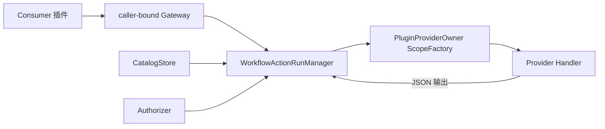

# Workflow Action：受治理的跨插件能力调用

> 核对日期：2026-09-28。依据：当前实现与文中源码、契约、测试链接。

[返回文档总览](../README.md)

## 模块结构

Workflow Action 用于插件之间以 JSON 契约调用能力。Gateway 绑定调用者身份；Run 提供调用治理范围；每次 Handler 调用使用 Provider 私有 Scope。它不把当前活动 Document 当作执行目标。

## 阅读顺序

1. [目录、身份与 Schema](01-contracts-and-catalog.md)。
2. [授权与调用 Scope](02-invocation-and-authorization.md)。
3. [预算、取消和退出](03-budgets-and-shutdown.md)。

完整参数、资源限制和返回协议见[Workflow 契约](../../reference/workflow-actions.md)，插件接入见[开发指南](../../quick-start/workflow-action-development.md)。

## 当前边界

同一插件可同时是 Provider 和 Consumer，但不能通过 Gateway 调用自己的 Action；Handler 异步调用链中也禁止嵌套 Workflow 调用。插件内部业务可以直接调用自己的服务，无须借跨插件协议绕行。
