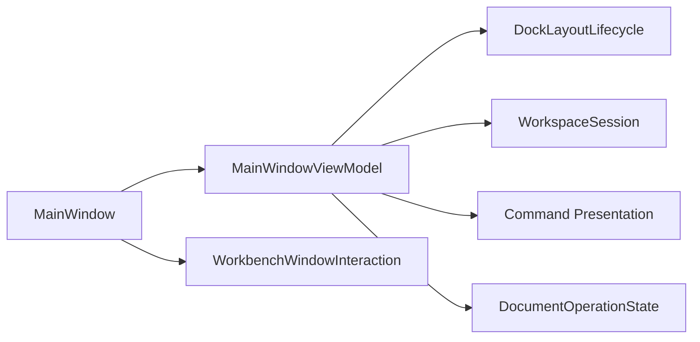

# 主窗口与绑定：谁协调 UI，谁拥有业务状态

> 核对日期：2026-09-28。依据：当前实现与文中源码、契约、测试链接。

[上层：界面呈现](README.md) · [文档总览](../README.md)

## 四种角色

| 角色 | 主要职责 |
| --- | --- |
| HostDesktopShell | 正式桌面生命周期和主窗口接入 |
| MainWindow / MainView | 原生窗口事件、控件和输入 |
| MainWindowViewModel | Layout、主题、错误与命令绑定，定向协调 |
| WorkbenchWindowInteraction | 各工作台窗口中的快捷键、面板和焦点交互 |



## 主 ViewModel 不重复实现打开和保存

[MainWindowViewModel](../../../Host/MyAvaloniaManagement/ViewModels/MainWindowViewModel.cs) 暴露 WorkbenchCommands，通过既有命令展示绑定提供菜单与快捷键；文档错误读取 Runtime 唯一 OperationState。它不直接解释信封或写文件。

PrepareWindowCloseAsync 先等待 Workspace 应用关闭许可，再调用布局冻结与排空。若布局准备失败，CancelWindowClose 撤销工作区关闭并恢复布局捕获。这个协调属于主窗口用例，不应拆成互不知情的窗口事件处理器。

## 订阅也是资源

ViewModel 是瞬态对象，Session 等是根级长寿命对象。若不退订，单例委托会延长窗口寿命。构造函数先订阅再准备布局；布局准备抛异常时对象无法交给 DI，必须在构造 catch 中主动撤销订阅。

以下源码片段省略说明性注释，保留执行语句和顺序。

```csharp
catch
{
    ReleaseCoordinationSubscriptions();
    throw;
}
```

这段源码保护半构造对象。正常 Dispose 同样成对退订，而不是销毁共享 Session。

## 窗口私有状态与共享状态

不同窗口拥有自己的输入绑定、焦点及内容全屏租约，共享当前 Runtime 的工作区和命令事实。WindowContentFullscreenSession 按租约引用判断释放，旧租约不得清掉后来展示的新内容。错误线程的释放也不能消耗有效租约。

源码：[HostDesktopShell](../../../Host/MyAvaloniaManagement/Business/Presentation/HostDesktopShell.cs)、[WorkbenchWindowInteraction](../../../Host/MyAvaloniaManagement/Business/Presentation/WorkbenchWindowInteraction.cs)、[WindowContentFullscreenSession](../../../Host/MyAvaloniaManagement/Business/Presentation/WindowContentFullscreenSession.cs)。验证：[ApplicationAndWindowTests](../../../Host/MyAvaloniaManagement.UiTests/ApplicationAndWindowTests.cs)、[WorkbenchCommandPresentationUiTests](../../../Host/MyAvaloniaManagement.UiTests/WorkbenchCommandPresentationUiTests.cs)。
