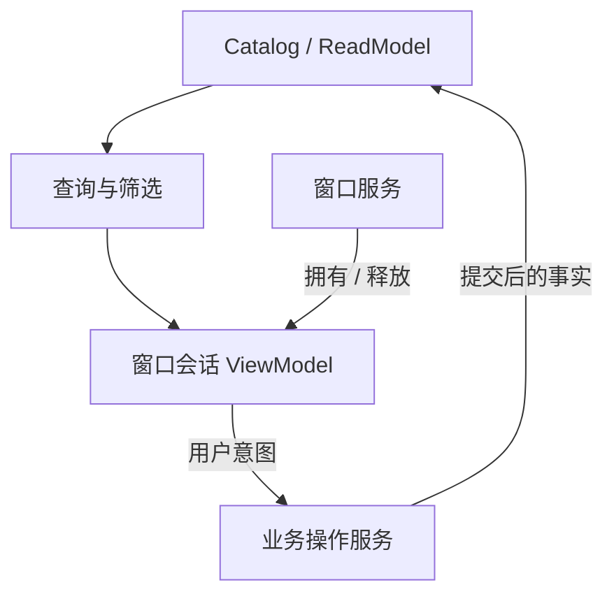

# 功能中心、工具中心与插件看板：查询和操作分开

> 核对日期：2026-09-28。依据：当前实现与文中源码、契约、测试链接。

[上层：界面呈现](README.md) · [文档总览](../README.md)

## 三个窗口消费不同事实

| 窗口 | 查询内容 | 操作入口 |
| --- | --- | --- |
| 功能中心 | 可用创建入口、分类、名称和图标 | DocumentPersistenceCoordinator |
| 工具中心 | 注册工具、实例显隐、收藏和最近访问 | ToolCenterActions |
| 插件看板 | 运行候选、注册、可用性、诊断、兼容证据及安装状态 | 启用、安装、重启窄端口 |

## 功能中心

[FunctionCenterWindowService](../../../Host/MyAvaloniaManagement/Business/Presentation/FunctionCenterWindowService.cs) 在 Runtime 内拥有一个选择窗口，每次打开建立独立会话。显示命令不等待用户选择，避免把整个窗口存活期计入待排空 Command。

但关闭选择窗口不等于文档创建已结束。正在 InitializeAsync 的请求仍由文档门和原调用链负责，退出需等待它。创建结果携带页面身份，焦点恢复不能用迟到全局活动页代替。

## 工具中心

查询合并完整目录与当前工作区状态，隐藏项和不可用历史项仍有合理展示来源。偏好保存收藏和分类，Layout 保存空间状态。ToolCenterActions 只在实际访问成功后更新最近工具，不能先修改 UI 再期望 Dock 一定成功。

## 插件看板

[PluginStatusQuery](../../../Host/MyAvaloniaManagement/Business/PluginStatus/PluginStatusQuery.cs) 聚合运行事实；[PluginDashboardEvidence](../../../Host/MyAvaloniaManagement/Business/Compatibility/PluginDashboardEvidence.cs) 提供兼容报告读取与导入，不加载或执行插件。

安装面板展示磁盘基线、预览和待应用版本，原插件列表展示本次运行。检查 ZIP 通过、安装文件就位、生命周期就绪分别有独立含义。UI 通过操作端口请求，不获取 Loader 或 Provider。

## 异步展示寿命

窗口关闭后解除订阅并停止对控件的回写；服务已接受的设置或安装提交继续按自身协议结束。刷新与操作应携带当前会话条件，迟到结果不能复活已关闭窗口。

验证：[PluginNavigationUiTests](../../../Host/MyAvaloniaManagement.UiTests/PluginNavigationUiTests.cs)、[ToolCenterUiTests](../../../Host/MyAvaloniaManagement.UiTests/ToolCenterUiTests.cs)、[PluginStatusWindowTests](../../../Host/MyAvaloniaManagement.UiTests/PluginStatusWindowTests.cs)、[PluginInstallationWindowTests](../../../Host/MyAvaloniaManagement.UiTests/PluginInstallationWindowTests.cs)。
