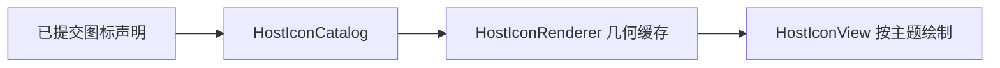
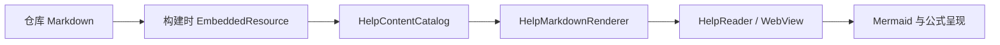

# 主题、图标与帮助：Host 统一呈现的支撑机制

> 核对日期：2026-09-28。依据：当前实现与文中源码、契约、测试链接。

[上层：界面呈现](README.md) · [文档总览](../README.md)

## 主题所有权

App.axaml 组合全局主题和样式，ApplicationThemeService 只切换 Host 主题模式并持久化偏好。插件可使用语义画刷和局部样式，不应在基础 SDK 中携带桌面后端或全局主题所有权。

## 图标是声明资源

HostIconCatalog 解析 builtin 与合法插件图标引用；Renderer 在 UI 线程处理几何缓存。搜索结果只需要图标描述，不应为了显示一行搜索项构造业务控件。资源对象也不能随意跨加载上下文传递。

## 帮助内容的真实链路

[Host 工程](../../../Host/MyAvaloniaManagement/MyAvaloniaManagement.csproj) 会收录根 docs 和 Host 内部 docs 的 Markdown。[HelpContentCatalog](../../../Host/MyAvaloniaManagement/Business/Help/HelpContentCatalog.cs) 保留八个固定章节，并支持通过 reference 路径定位其他嵌入文档。新增文章不会自动成为第九个主章节，全文搜索也不应被推断为自动覆盖全部新文章。

[HelpMarkdownRenderer](../../../Host/MyAvaloniaManagement/Business/Help/HelpMarkdownRenderer.cs) 使用 Markdig，禁用原始 HTML，保护公式再转换 Markdown；Mermaid 围栏交给帮助页脚本渲染。代码链接在仓库阅读器中可跳源码，安装版帮助只解析已嵌入的文档目标，不提供完整源码浏览器。

## 本文档组的接入方式

在主导航和已有架构原文添加入口，可沿引用进入这套嵌入文档。保留原固定章节身份及原文路径，避免破坏已有帮助收藏和引用。构建后需验证新资源实际存在、文本一致、Markdown 可渲染；Mermaid 还需单独进行语法或实际渲染检查。

SDK 包、Packaging 和 patches 下的 README 也属于仓库材料，不在这两组 docs 的嵌入范围内；源码地图中的这些链接需在仓库打开。

源码：[HostIconCatalog](../../../Host/MyAvaloniaManagement/Business/Presentation/Icons/HostIconCatalog.cs)、[HelpWindowService](../../../Host/MyAvaloniaManagement/Business/Help/HelpWindowService.cs)。验证：[IconRenderingUiTests](../../../Host/MyAvaloniaManagement.UiTests/IconRenderingUiTests.cs)、[HelpContentTests](../../../Host/MyAvaloniaManagement.Tests/HelpContentTests.cs)、[HelpWindowTests](../../../Host/MyAvaloniaManagement.UiTests/HelpWindowTests.cs)。
