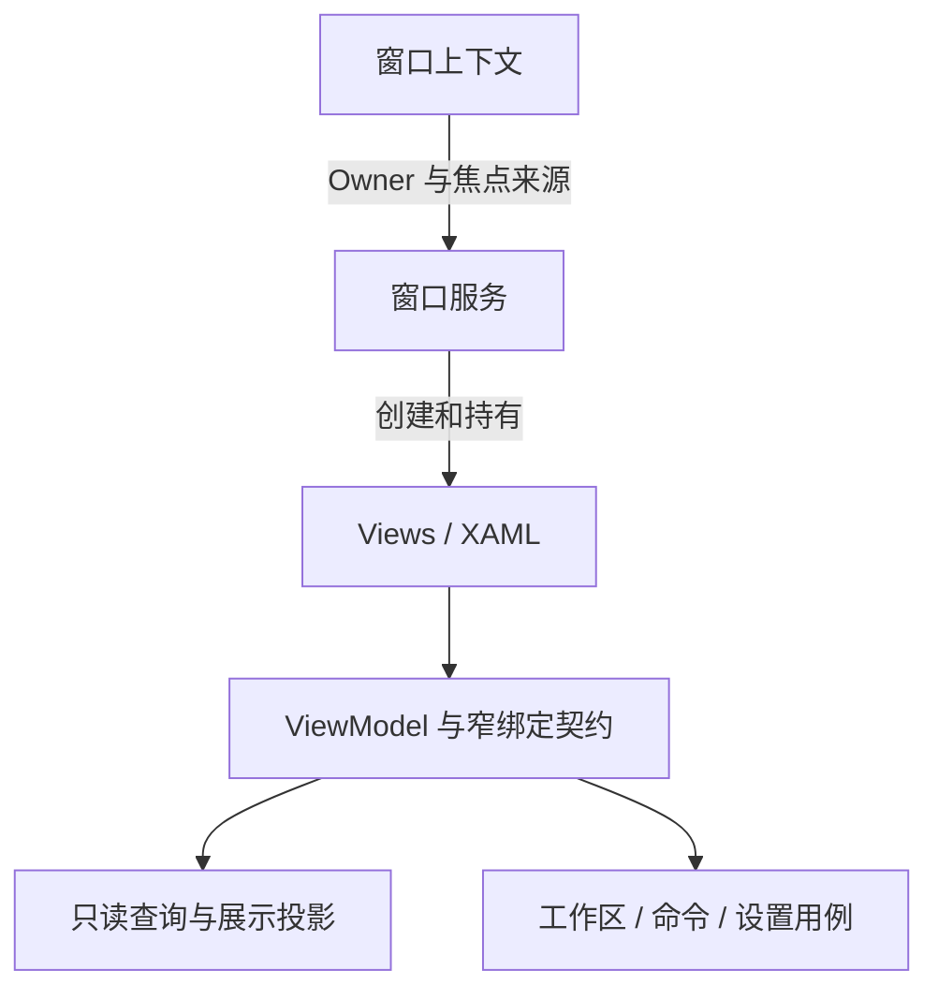

# 界面呈现：窗口、绑定、功能入口与帮助

> 核对日期：2026-09-28。依据：当前实现与文中源码、契约、测试链接。

[返回文档总览](../README.md)

## 呈现层如何消费业务

呈现层负责把状态变为可操作界面，也负责窗口会话寿命。它可以协调真实 UI 行为，但文件事务、插件容器和 Dock 业务状态各有专门所有者。

## 阅读顺序

- [主窗口与 MVVM](01-shell-and-bindings.md)。
- [功能中心、工具中心与看板](02-centers-and-dashboard.md)。
- [主题、图标与帮助](03-appearance-icons-help.md)。

命令面板的候选与执行规则在[命令呈现](../06-commands/04-presentation-and-palette.md)。独立窗口服务的共同关注点是 Owner、单窗口、订阅、迟到异步结果和释放，而非统一套用一个复杂窗口管理框架。
