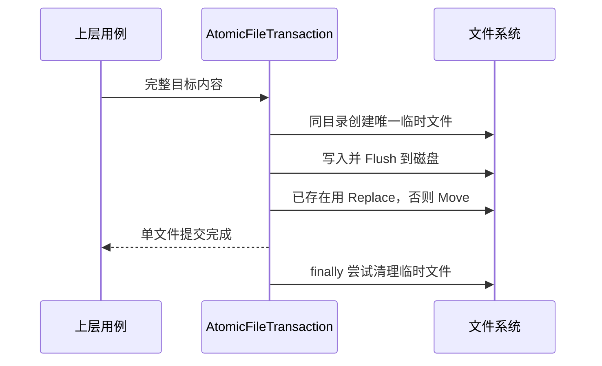

# 存储与原子事务：单文件提交和上层业务提交

> 核对日期：2026-09-28。依据：当前实现与文中源码、契约、测试链接。

[上层：支撑能力](README.md) · [文档总览](../README.md)

## 从用例到文件系统

IHostStorageService 隔离文件选择、路径存在性、读前长度与文本写入；AvaloniaHostStorageService 适配本机和 UI 文件选择；AtomicFileTransaction 负责同目录临时文件的最终替换。



## 核心源码

[AtomicFileTransaction.Commit](../../../Host/MyAvaloniaManagement/Business/Storage/AtomicFileTransaction.cs)：

```csharp
if (File.Exists(destinationPath))
{
    File.Replace(temporaryPath, destinationPath, null);
}
else
{
    File.Move(temporaryPath, destinationPath);
}
```

临时文件与目标同目录，避免跨卷移动改变提交语义。写入内容完整并刷新后才替换旧文件。该辅助类不拥有备份、格式迁移或用户提示，这些由 Document、Layout 或设置用例决定。

## 单文件原子不等于多文件事务

Document 主文件与 recovery 备份是先后两次提交，因此备份失败不能回滚主文件事实。安装登记与操作日志也是不同文件，依赖显式恢复协议。不能因为底层都调用原子替换，就把多个文件写入宣称为一笔原子事务。

## 路径也是领域边界

HostDataRootPolicy 确定 Host 状态根；插件发现根与安装管理根有自己的路径策略。数据根换位置不能绕过同一个插件根的运行租约。

DocumentPathIdentity 管理文档路径身份；文件树的 FileSystemPath 负责输入路径分类。文件树从字符串校验到 DirectoryExists，再一次提交根节点与标题，失败保留原 UI 状态。UNC 共享根与本地驱动器集合有不同展示语义。

源码：[IHostStorageService](../../../Host/MyAvaloniaManagement/Business/Storage/IHostStorageService.cs)、[HostDataRootPolicy](../../../Host/MyAvaloniaManagement/Business/Storage/HostDataRootPolicy.cs)、[DocumentPathIdentity](../../../Host/MyAvaloniaManagement/Business/Documents/DocumentPathIdentity.cs)。验证：[HostStorageServiceTests](../../../Host/MyAvaloniaManagement.Tests/HostStorageServiceTests.cs)、[HostDataRootPolicyTests](../../../Host/MyAvaloniaManagement.Tests/HostDataRootPolicyTests.cs)、[DocumentPersistenceTests](../../../Host/MyAvaloniaManagement.Tests/DocumentPersistenceTests.cs)。
