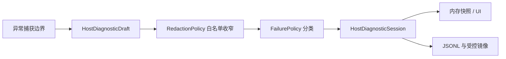

# 诊断与错误边界：草稿如何成为可保存记录

> 核对日期：2026-09-28。依据：当前实现与文中源码、契约、测试链接。

[上层：支撑能力](README.md) · [文档总览](../README.md)

## 诊断数据流

Draft 可以带异常和候选上下文；长期保存的 Record 只能包含被允许的字段。这里采用白名单复制和固定消息映射，避免依赖“查找密码关键词并替换”的不完整策略。

## 错误码、阶段与处置

| 字段 | 用途 |
| --- | --- |
| Code | 稳定错误身份，供查询和测试 |
| Phase | 发生在哪个 Host 阶段 |
| Severity | 严重程度 |
| Disposition | 是隔离候选、报告可恢复失败还是终止启动等 |
| ExceptionType | 异常类型线索 |
| UserMessage / TechnicalDetail | Host 生成的受控说明 |

PluginId、稳定身份和有限目录叶名按格式筛选；插件异常正文、业务 payload、完整路径和任意字符串不直接进入默认记录。未知但格式合法的码可以保留身份，用户消息仍采用阶段级固定文本。

## 会话所有权

[HostDiagnosticSession](../../../Host/MyAvaloniaManagement/Business/Diagnostics/HostDiagnosticSession.cs) 独占记录、锁和写入器。Program 的日志寿命覆盖 Runtime 收尾；生命周期诊断出口在日志释放前关闭。诊断保存不可用时仍需要保留受控内存事实，并由相应政策报告问题。

敏感调试旁路与默认记录分开，不应通过方便调试的临时输出扩大默认持久化内容。

## 操作错误不都进入同一策略

DocumentPersistenceErrorMapper 把预期文件或插件边界错误映射为固定 UI 消息；批量打开以文件为失败边界。保存服务捕获插件回调异常并返回结构化状态。编程错误不应普遍伪装成可恢复文件错误。

“错误已经展示”与“清理已经完成”也不同：启动失败页仍可能有保留的对象图，Runtime 的结构化关闭结论才说明释放状态。

源码：[RedactionPolicy](../../../Host/MyAvaloniaManagement/Business/Diagnostics/HostDiagnosticRedactionPolicy.cs)、[FailurePolicy](../../../Host/MyAvaloniaManagement/Business/Diagnostics/HostDiagnosticFailurePolicy.cs)、[DocumentPersistenceErrorMapper](../../../Host/MyAvaloniaManagement/Business/Documents/DocumentPersistenceErrorMapper.cs)。验证：[HostDiagnosticsTests](../../../Host/MyAvaloniaManagement.Tests/HostDiagnosticsTests.cs)、[WorkbenchCommandDiagnosticTests](../../../Host/MyAvaloniaManagement.Tests/WorkbenchCommandDiagnosticTests.cs)。
