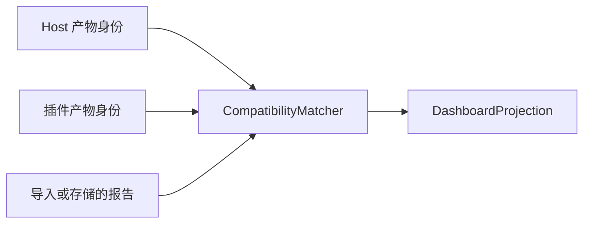

# 兼容性与框架补丁：契约、产物身份和验证证据

> 核对日期：2026-09-28。依据：当前实现与文中源码、契约、测试链接。

[上层：支撑能力](README.md) · [文档总览](../README.md)

## 三种判断不要合并

| 判断 | 根据 | 能说明什么 |
| --- | --- | --- |
| API 契约兼容 | SDK public surface 与基线 | 接口签名是否按规则演进 |
| 运行加载兼容 | manifest SDK 区间、依赖和共享策略 | 当前 Host 是否接受加载 |
| 验证证据匹配 | Host/插件产物身份与报告 | 某份报告是否对应当前被检查产物 |

三者都不自动证明插件业务正确或已完成用户人工验收。

## 看板检查是快照

PluginArtifactReader 和 ArtifactFingerprint 从文件得到结构与摘要；PluginDashboardEvidence 提供读取及导入端口，不触发插件发现或执行。检查之后磁盘还可能变化，所以结果必须被理解为有时间边界的快照。

安装预检复用格式和指纹规则，但摘要一致只说明内容匹配，不代表作者签名或独立信任来源。安装成功也不自动生成兼容测试通过结论。

## 两处框架补丁

[Avalonia 跨窗布局补丁](../../../patches/avalonia-cross-window-layout/README.md) 修复迁移控件在旧布局根队列中的残留处理；Host 的回收器仍负责唯一 View 与最终释放。

[Dock 区域填充补丁](../../../patches/dock-area-fill/README.md) 服务工作台区域重建和回停行为；HostDockFactory、ToolDockCoordinator 继续拥有业务适配与目标判断。补丁不是插件可任意引用的业务接口。

运行资产选择、包身份与摘要核对在构建层完成。修改插件 SDK 的 UI 类型契约和替换 Host 运行资产是不同动作，应分别验证。

## 验证与发布

日常开发 Gate、专项测试、本机部署、真实人工验收和公开发布各自留证。不能从旧版本封板记录推断当前工作树已具备发布资格，也不能为了让发布检查通过而清空 API 基线。

源码：[CompatibilityMatcher](../../../Host/MyAvaloniaManagement/Business/Compatibility/CompatibilityMatcher.cs)、[PluginDashboardEvidence](../../../Host/MyAvaloniaManagement/Business/Compatibility/PluginDashboardEvidence.cs)。权威入口：[API 基线](../../reference/plugin-sdk-api-compatibility.md)、[兼容证据](../../reference/plugin-compatibility.md)、[验证流程](../../maintenance/verification.md)。测试：[PluginCompatibilityEvidenceTests](../../../Host/MyAvaloniaManagement.Tests/PluginCompatibilityEvidenceTests.cs)、[PluginSdkApiBaselinePolicyTests](../../../Host/MyAvaloniaManagement.PluginTests/PluginSdkApiBaselinePolicyTests.cs)、[DockCrossWindowLayoutUiTests](../../../Host/MyAvaloniaManagement.UiTests/DockCrossWindowLayoutUiTests.cs)。
