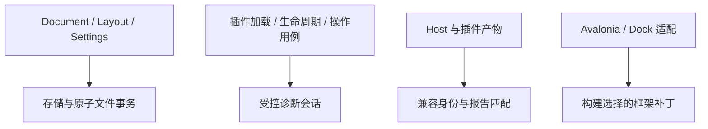

# 支撑能力：存储、诊断、兼容性和框架补丁

> 核对日期：2026-09-28。依据：当前实现与文中源码、契约、测试链接。

[返回文档总览](../README.md)

## 横向能力也需要明确所有者

本目录解释上层模块共用的底层边界。它们不会替代业务提交：原子写入只保证一个文件替换；兼容摘要不保证业务正确；记录诊断也不意味着完成回滚。

## 阅读顺序

- [存储与原子文件事务](01-storage-and-transactions.md)。
- [诊断与错误边界](02-diagnostics-and-errors.md)。
- [兼容性、构建和补丁](03-compatibility-and-patches.md)。

线程和资源的全局查找入口见[所有权矩阵](../11-reference/02-ownership-and-threading.md)。
