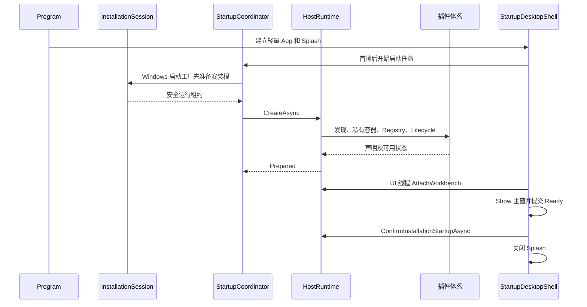

# 场景：启动 Host 并显示可用工作台

> 核对日期：2026-09-28。本篇串联当前实现；局部机制、源码和验证入口见文内下钻链接。

[上层：跨模块流程](README.md) · [文档总览](../README.md)

## 场景与成功条件

用户启动正常 Host 进程。成功条件是主窗口完成交接、启动状态 Ready，且安装试运行若存在也完成相应确认。它不是单纯“插件扫描结束”。

## 逐步源码路径

1. [Program.Run](../../../Host/MyAvaloniaManagement/Program.cs) 先识别助手参数；正常分支建立诊断、交接和启动工厂。
2. [StartupDesktopShell.Attach](../../../Host/MyAvaloniaManagement/Business/Presentation/StartupDesktopShell.cs) 显示首屏，首帧后安排启动。
3. [HostRuntime.CreateAsync](../../../Host/MyAvaloniaManagement/Business/Composition/HostRuntime.cs) 建立各模块，保持 UI 对象延迟解析。
4. 同文件 AttachWorkbench 进入正式窗口对象图，随后展示与确认。

## 失败分支

禁用插件不创建 ALC；可隔离候选失败不阻止其他插件。组合或主窗交接致命失败则保留原始诊断，关闭未交付窗口并执行 Runtime 回滚。用户取消启动同样需要等待工厂返回，不能只关闭 Splash 后丢掉 Runtime。

继续放大：[启动状态](../01-runtime/01-startup-and-composition.md)、[插件发现](../02-plugins/01-discovery-and-loading.md)、[安装准备](../02-plugins/05-installation-and-recovery.md)。证据入口：[StartupPluginProgressTests](../../../Host/MyAvaloniaManagement.PluginTests/StartupPluginProgressTests.cs)、[StartupSplashUiTests](../../../Host/MyAvaloniaManagement.UiTests/StartupSplashUiTests.cs)。
