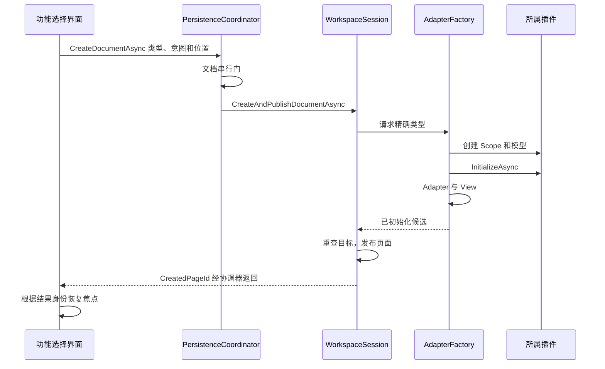

# 场景：从功能入口新建插件 Document

> 核对日期：2026-09-28。本篇串联当前实现；局部机制、源码和验证入口见文内下钻链接。

[上层：跨模块流程](README.md) · [文档总览](../README.md)

## 场景与入口

用户在功能中心、目录树或命令面板选择某个创建入口。系统使用 DocumentTypeId 与可选 CreationIntentId，窗口来源明确的入口还携带 DocumentCreationTarget。

## 各模块交接的内容

UI 交出的是稳定类型、意图和借用的位置，不是 IServiceProvider。Activator 交出模型及窄 Scope Lease，AdapterFactory 交出可发布适配器，Session 交出真实页面身份。每一层只增加当前职责需要的信息。

成功点是 Session 发布完成；Scope 已创建和 InitializeAsync 返回都只是中间状态。目录列表先前显示可用，也不能免除执行时复核。

## 异步期间发生变化

来源分组被移除时按目标解析规则重新选择合法位置；来源窗口关闭、工作区退出或发布失败时回滚候选。UI 关闭之后原创建 Task 仍需有人观察，不能把窗口消失当作任务取消完成。

已有页面不会因为新建失败被重建。View 构造异常、状态登记异常和发布异常都应走当前责任边界的回收。

继续放大：[创建内部时序与源码](../04-documents/03-create-and-activate.md)、[Pending 发布义务](../03-workspace/01-catalog-session-activation.md)、[位置解析](../03-workspace/02-pages-targets-and-queries.md)。测试入口：[DocumentPersistenceTests](../../../Host/MyAvaloniaManagement.Tests/DocumentPersistenceTests.cs)、[DocumentCreationTargetTests](../../../Host/MyAvaloniaManagement.Tests/DocumentCreationTargetTests.cs)。
