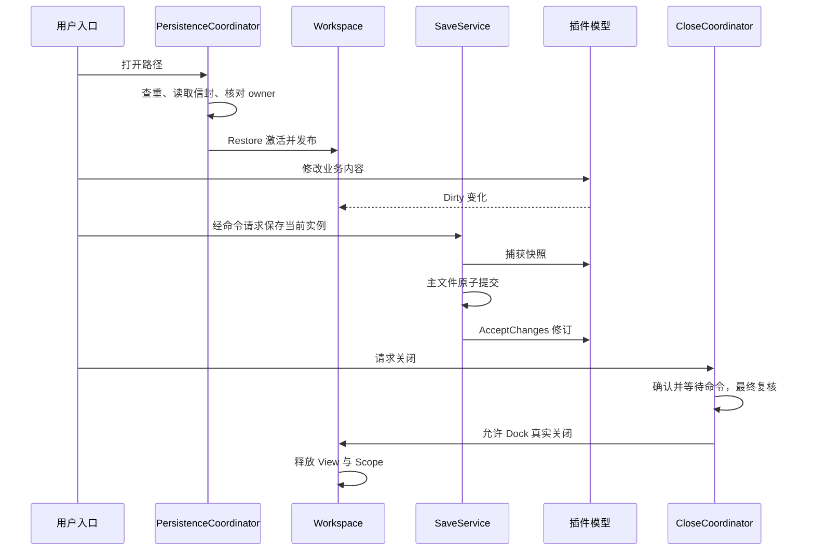

# 场景：打开文件、修改、保存并关闭

> 核对日期：2026-09-28。本篇串联当前实现；局部机制、源码和验证入口见文内下钻链接。

[上层：跨模块流程](README.md) · [文档总览](../README.md)

## 正常主链

## 三个成功点

打开成功是内容初始化且页面发布完成；保存成功是主文件提交；关闭成功是框架完成关闭并进入资源释放。它们依次关联，但不能合并为一个布尔值。

如果文件已打开，打开流程激活同一路径的实例。主文件格式或内容初始化失败时，只有完整准备好合法备份才提供恢复机会；恢复页面要求另存。

## 保存期间又有编辑

快照 R1 已写入，而模型变为 R2 时，保存仍成功，IsDirty 可继续为 true。关闭操作必须保留未保存的 R2，不能凭 Saved 直接销毁模型。备份失败和修订确认异常则作为提交后的警告单独解释。

## 关闭时仍有命令执行

CloseCoordinator 阻止该页新命令并等待已有命令，再检查最终脏状态。用户放弃许可只覆盖当时明确确认的文档。原本干净、等待期间变脏的页面不会隐式获得放弃许可。

继续放大：[打开与恢复](../04-documents/04-open-and-restore.md)、[保存](../04-documents/05-save-and-revision.md)、[关闭](../04-documents/06-close-and-release.md)。代码从 [Coordinator](../../../Host/MyAvaloniaManagement/Business/Documents/DocumentPersistenceCoordinator.cs)、[SaveService](../../../Host/MyAvaloniaManagement/Business/Documents/DocumentSaveService.cs)、[CloseCoordinator](../../../Host/MyAvaloniaManagement/Business/Documents/DocumentCloseCoordinator.cs) 顺读。验证：[DocumentPersistenceTests](../../../Host/MyAvaloniaManagement.Tests/DocumentPersistenceTests.cs)、[DocumentCloseTests](../../../Host/MyAvaloniaManagement.Tests/DocumentCloseTests.cs)。
